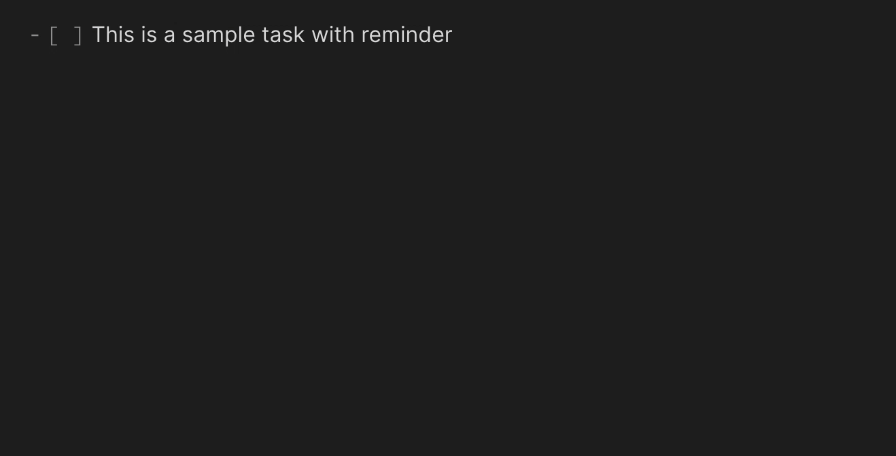
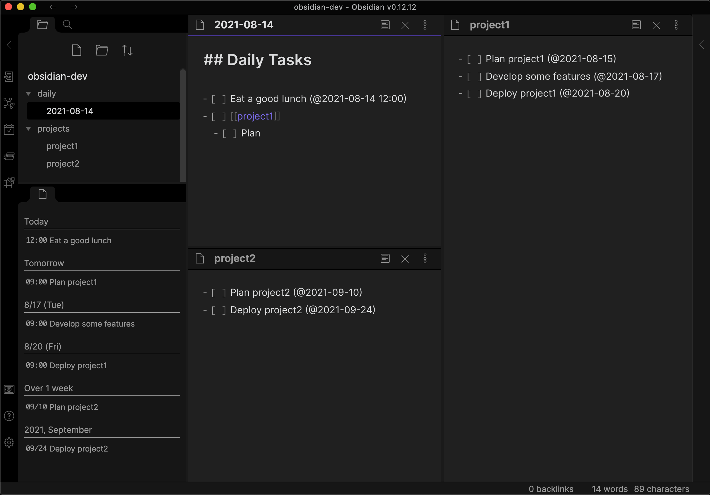
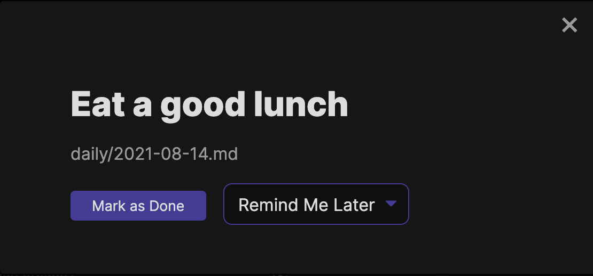
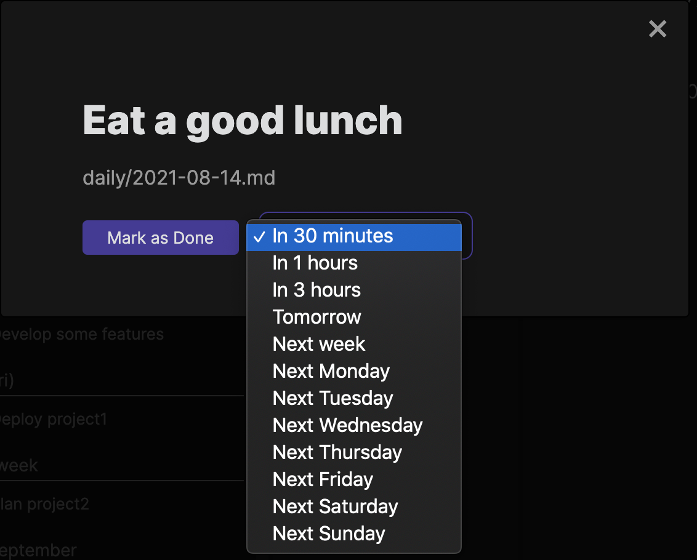

## Obsidian Reminder Plugin

[Reminder plugin](https://uphy.github.io/obsidian-reminder/) for Obsidian. This plugin adds feature to manage markdown TODOs with reminder.

### Features

#### Set Reminders

You can [set reminders](https://uphy.github.io/obsidian-reminder/guide/set-reminders.html) for TODO list items with the following format.

```markdown
- [ ] This is a sample task with reminder (@2021-08-14)
- [ ] Also you can specify time (@2021-08-14 09:37)
- [x] You will not be notified about the reminders you have already checked. (@2021-08-14)
```



#### List Reminders

You can [view the list of reminders](https://uphy.github.io/obsidian-reminder/guide/list-reminders.html) contained in all files.



If you click the reminder list item, the source markdown file will be appeared.

#### Reminder Notification

Reminder will be [notified](https://uphy.github.io/obsidian-reminder/guide/notification.html) on Obsidian when the time comes.



If you click `Mark as Done`, your check list item will be checked.
Alternatively, you can postpone the reminder by selecting `Remind Me Later`.




#### Note Reminders

A note can also remind you from a date in its properties, without a task line. See [note reminders](https://uphy.github.io/obsidian-reminder/guide/note-reminders.html).

```markdown
---
follow-up: 2026-11-20
---
```

List the properties to read in the settings. This works with a date column in an Obsidian Bases table and with dates other plugins keep in properties. `Mark as Done` records the handled date in `follow-up-done` and leaves your date alone, so writing the next date reminds you again.

#### Interoperability with other plugins

In addition to original format `@YYYY-MM-DD`, this plugin also supports following plugin formats.

- [Obsidian Tasks](https://uphy.github.io/obsidian-reminder/guide/interop-tasks.html) (e.g. `📅 2021-05-02`)
- [Kanban](https://uphy.github.io/obsidian-reminder/guide/interop-kanban.html) (e.g. `@{YYYY-MM-DD}`)
- [TaskNotes](https://uphy.github.io/obsidian-reminder/guide/interop-tasknotes.html) (reminders kept in a task note's `reminders` property)

If you use the [Natural Language Dates](https://uphy.github.io/obsidian-reminder/guide/interop-nldates.html) plugin, see the guide for how to avoid the `@` autocompletion conflict.

### Guide

https://uphy.github.io/obsidian-reminder/

### FAQ

- Notification in mobile (Android/iOS)
  - System notification in mobile device is not available because Obsidian doesn't provide the feature.

### Development

Requires [mise](https://mise.jdx.dev/) (which provides the pinned Node.js version), or Node.js 22 with plain npm.

```bash
mise run main:init      # install dependencies
mise run dev            # watch build; rebuilds on every save
mise run main:test      # run the test suite
mise run main:lint:fix  # eslint --fix + tsc --noEmit + svelte-check
```

To try your changes in a real vault, symlink this repository into the vault's plugin directory and install the [hot-reload](https://github.com/pjeby/hot-reload) plugin:

```bash
ln -s /path/to/obsidian-reminder /path/to/vault/.obsidian/plugins/obsidian-reminder-plugin
```

With `mise run dev` running, every save rebuilds the plugin and hot-reload reloads it in Obsidian automatically. See [CLAUDE.md](CLAUDE.md) for an overview of the codebase and the release flow.

### Support

<a href="https://www.buymeacoffee.com/uphy" target="_blank"></a>