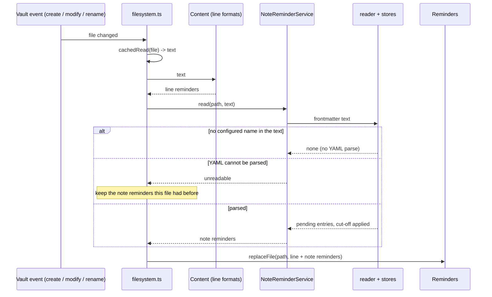
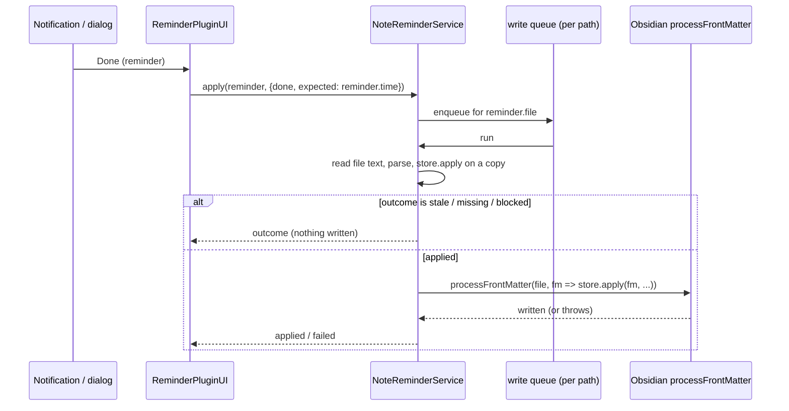

# Note-level reminders (reminders from properties)

*   **Author:** uphy
*   **Status:** Proposed
*   **Date:** 2026-11-14

--------------------------------------------------------------------------------

## Overview

Today a reminder is a task line with a date. This design adds reminders that
belong to a note. The time is a property in the note's frontmatter, and the
title is the note's name unless the user sets one.

The user lists the properties to read in the settings. Each listed property
that holds a date or a date-time becomes one reminder. "Done" and "Remind me
later" work from every notification surface the plugin has today, and both
write to the note. A dialog, a command, a file-menu item and a bell in the note
header let the user create and edit a reminder without typing frontmatter.

The feature ships in three releases:

1.  Plain properties, with the dialog and the bell.
2.  Recurrence.
3.  The `reminders` array that TaskNotes v4 keeps in task notes.

This document specifies all three. The detailed implementation plan covers the
first release and names the points where the second and third attach.

## The Problem

Three requests ask for a reminder that is not a task line:

*   A user keeps a "next follow-up" date as a column of an Obsidian Bases table
    and wants to be reminded from it
    ([uphy/obsidian-reminder#268](https://github.com/uphy/obsidian-reminder/issues/268)).
*   The Spaced Repetition plugin writes the next review date into the `sr-due`
    property. A user wants that date to remind
    ([uphy/obsidian-reminder#28](https://github.com/uphy/obsidian-reminder/issues/28)).
*   TaskNotes v4 keeps a `reminders` array in each task note. A contributor
    wants those in this plugin's notifications, with snooze
    ([uphy/obsidian-reminder#409](https://github.com/uphy/obsidian-reminder/pull/409)).

The plugin cannot serve them today for three reasons.

**It only reads lines.** A reminder is found by parsing one line of the note's
body, and it is identified by its line number. Frontmatter is never read.

**A property has no "not done" marker.** A task line has a checkbox. "Done"
checks it, and the reminder stops. A date property has nothing of the kind, so
the plugin has nowhere to record that a date was handled. The pull request for
TaskNotes kept that record in the plugin's `data.json`. That breaks a rule this
plugin holds: the note says what is due and what is done, and `data.json` holds
only settings, a cache that a rescan rebuilds, and notification state. With the
record in `data.json`, the note and the plugin can disagree, and a second
device that does not sync `data.json` notifies again for everything.

**The values belong to someone else.** A Bases column belongs to the user's own
workflow. `sr-due` and TaskNotes' entries belong to another plugin, which
rewrites them on its own schedule. "Done" must not delete or change a value the
plugin does not own, and a value that changes underneath an open notification
must not be marked as handled by mistake.

The design answers these with one rule. "Done" does not edit the value. It
writes the value it was notified about into a second property next to it,
`<property>-done`. A reminder is pending while the two differ. When the user or
another plugin writes a new date, the two differ again and the reminder fires
with no other edit.

## Goals

First release:

*   A property the user configured, holding a date or a date-time, produces a
    reminder on every surface a line reminder reaches: the in-app notification,
    the system notification, ntfy, and the reminder list.
*   "Done" and "Remind me later" on such a reminder write only to the note's
    frontmatter. A full rescan of the vault gives the same pending reminders as
    before the rescan.
*   "Done" never changes the reminded value. It works on a property written by
    the user, by Bases, or by another plugin.
*   An action taken on a notification whose value has since changed in the note
    writes nothing.
*   Upgrading changes nothing for an existing vault until the user adds a
    property to the settings.
*   Adding a property that already holds past dates across the vault produces no
    notifications for dates before a cut-off the user can see and edit.
*   A user can create, edit, complete and remove a reminder on a note from a
    dialog, without editing frontmatter by hand, and can see from the note
    header that the note has a pending reminder.
*   Line reminders behave as they do today. Their keys, mute flags and scheduled
    ntfy messages survive the upgrade.

Second release:

*   A reminder on a property the plugin manages can repeat. "Done" moves it to
    the next occurrence.

Third release:

*   TaskNotes `reminders` entries, absolute and relative, produce reminders with
    "Done" and snooze. The feature is off by default. TaskNotes' own entries are
    never modified.

Across releases:

*   The code that knows a frontmatter format is separate from the code that
    schedules, notifies and writes. The TaskNotes reader is added without
    changing the second.

## Non-Goals

*   A list of dates in one property. None of the three requests needs it. A
    note with several reminders can use task lines.
*   Changing how Obsidian's properties panel or a Bases cell looks. Obsidian
    offers no supported way to do it.
*   Creating, editing or removing the value of a property the plugin does not
    manage (`follow-up`, `sr-due`) from the dialog.
*   Showing "done" as a checkbox in the properties panel. The state is two
    equal dates. A Bases formula column, the header bell and the reminder list
    show it.
*   Reading TaskNotes' settings or calling its internal functions.
*   TaskNotes recurring tasks.
*   Completing a TaskNotes task from a notification.
*   Suppressing TaskNotes' own notifications. With both plugins notifying, the
    user turns one off.
*   A public API for stores written by third parties.
*   Preserving YAML comments, quoting style and inline list style in a note's
    frontmatter when the plugin writes to it. Obsidian's frontmatter API
    rewrites the block, as Obsidian's own properties panel does.

## Open Questions

*   **Snooze on another plugin's property**: Should "Remind me later" be
    offered for a property another plugin owns, such as `sr-due`? It rewrites
    that plugin's date. Reading and "Done" were run against Spaced Repetition;
    snooze was not.
*   **Mobile**: Nothing was run on a phone or tablet. The header bell and the
    dialog need a check there before the first release.
*   **Settings page layout**: The row-per-source layout was not built. A person
    needs to look at it.

## Critical User Journeys (CUJs)

### CUJ 1: A Bases follow-up date reminds and re-arms

*   **Given**: The settings list `follow-up` as an external property with a
    cut-off of today. A note has `follow-up: 2026-11-20`.
*   **When**: November 20 arrives at the configured "Reminder Time". The user
    presses "Done". A week later the user types `2026-12-05` into the Bases
    cell.
*   **Then**: A notification shows the note name with "follow-up · 2026-11-20".
    After "Done" the note has `follow-up: 2026-11-20` and
    `follow-up-done: 2026-11-20`, and nothing more fires. After the edit the
    note reminds on December 5, with no other step.

### CUJ 2: A reminder set from the dialog

*   **Given**: The settings list `reminder` as a managed property. A note has
    no frontmatter.
*   **When**: The user runs "Set reminder for this note", picks tomorrow 09:00,
    types the title "Send the report", and saves.
*   **Then**: The note has `reminder: <tomorrow>T09:00:00` and
    `reminder-title: Send the report`. A bell appears in the note header. At
    09:00 the notification is titled "Send the report". The bell disappears
    after "Done".

### CUJ 3: Another plugin moves the date under an open notification

*   **Given**: `sr-due` is an external property. A notification for
    `sr-due: 2026-11-20` is on screen.
*   **When**: The user reviews the note in Spaced Repetition, which rewrites
    `sr-due` to `2026-11-27`. The user then presses "Done" on the old
    notification.
*   **Then**: Nothing is written. The old notification is dropped. The note
    reminds on November 27.

### CUJ 4: Enabling a property with years of past dates

*   **Given**: 300 notes have a `follow-up` date in the past. The property is
    not configured.
*   **When**: The user adds `follow-up` to the settings today.
*   **Then**: The row's cut-off is prefilled with today and shows "300 values
    ignored". No notification fires for them. A note whose `follow-up` is set
    to next week reminds next week.

### CUJ 5: Snoozing a date-only reminder

*   **Given**: `follow-up: 2026-11-20` has fired.
*   **When**: The user opens "Remind me later".
*   **Then**: Only whole-day options ("Tomorrow", "Next week") are offered.
    Choosing "Tomorrow" writes `follow-up: 2026-11-21`, still a date, so the
    Bases column keeps rendering as a date.

### CUJ 6: Upgrade without configuration

*   **Given**: A vault with line reminders, some muted, some scheduled on ntfy,
    and some notes that happen to have a `reminder` property.
*   **When**: The plugin is upgraded.
*   **Then**: No note reminder exists. Mute flags and ntfy messages of line
    reminders are unchanged.

### CUJ 7 (second release): A monthly reminder

*   **Given**: A managed property with `reminder: 2026-11-20T09:00:00` and
    `reminder-repeat: every month`.
*   **When**: The user snoozes it by 30 minutes, then presses "Done".
*   **Then**: `reminder-done` holds the occurrence that was handled and
    `reminder` is `2026-12-20T09:00:00`, not 09:30.

### CUJ 8 (third release): A TaskNotes relative reminder

*   **Given**: TaskNotes reading is on. A task note has `due: 2026-11-20T10:00`
    and a `reminders` entry "15 minutes before due".
*   **When**: 09:45 arrives and the user presses "Done". Later the user moves
    `due` to November 27 in TaskNotes.
*   **Then**: The entry is unchanged and `reminders-done` holds the entry's id
    with the time it fired for. After `due` moves, the same entry reminds at
    09:45 on November 27.

## Technical Plan (Architecture)

### 1. What is stored in the note

For a configured property `p`:

| Property | Meaning | Written by |
| --- | --- | --- |
| `p` | The time: a date (`2026-11-20`) or a date-time (`2026-11-20T09:00:00`). Empty means nothing is scheduled. | The user, Bases, another plugin, or this plugin (dialog, snooze, recurrence) |
| `p-done` | The value of `p` that was last marked done. | This plugin only |
| `p-title` | Optional title. Managed properties only. | The dialog or the user |
| `p-repeat` | Optional recurrence rule. Managed properties only. Second release. | The dialog or the user |

A reminder is **pending** when `p` parses as a time and `p-done` does not hold
the same time. It **notifies** when it is pending and its time has passed.

Parsing and comparison:

*   A value is a time when it is a string in the form `YYYY-MM-DD`, or
    `YYYY-MM-DD` followed by `T` or a space and `HH:mm`, with optional seconds
    and an optional UTC offset. Everything else (other text, a number, a list,
    a checkbox) is not a reminder.
*   A date and a date-time are different values, even at midnight.
*   Two date-times are equal when they are the same instant at minute
    precision. A value with a UTC offset is converted to local time when read.
*   The plugin writes local times without an offset: `YYYY-MM-DD` for a date,
    `YYYY-MM-DDTHH:mm:00` for a date-time. That is the form Obsidian's property
    editor writes.

What each action writes:

| Action | Precondition | Write |
| --- | --- | --- |
| Done | `p` still equals the notified value | `p-done` := notified value |
| Done, with `p-repeat` (second release) | same | `p-done` := notified value, then `p` := next occurrence |
| Remind me later | `p` still equals the notified value | `p` := new time, in the shape of the old value. If the new value equals `p-done`, `p-done` is removed. |
| Save in the dialog | `p` is a managed property and is empty or a time | `p` := chosen time; `p-title` set or removed; `p-done` removed if it equals the new value |
| Remove in the dialog | `p` is a managed property | `p`, `p-title`, `p-repeat`, `p-done` removed |

Two guards apply to every write:

*   **Stale action.** Every "Done" and "Remind me later" carries the time the
    notification was shown for. If `p` no longer holds that time, nothing is
    written.
*   **Foreign companion.** If `p-done` exists and is not a time (a checkbox or
    text column the user already had under that name), "Done" writes nothing
    and a notice names the property.

### 2. Layers

```text
 src/model/note/            pure, no Obsidian import, unit-tested
 ┌──────────────────────────────────────────────────────────┐
 │ value.ts        parse / format / compare a time value    │
 │ store.ts        NoteReminderStore interface, outcomes    │
 │ property-store  plain properties (release 1, 2)          │
 │ tasknotes-store TaskNotes entries (release 3)            │
 │ reader.ts       frontmatter text -> entries -> Reminder  │
 │                 applies the cut-off; routes actions      │
 └──────────────────────────────────────────────────────────┘
 src/plugin/                depends on Obsidian
 ┌──────────────────────────────────────────────────────────┐
 │ note-reminders.ts  NoteReminderService: parse YAML,      │
 │                    write through processFrontMatter      │
 │ write-queue.ts     one promise chain per file path       │
 │ filesystem.ts      merges line + note reminders per file │
 │ ui/                dialog, header bell, notifications    │
 └──────────────────────────────────────────────────────────┘
```

The store interface (types, not code to copy):

```ts
type Frontmatter = Record<string, unknown>;

type NoteReminderEntry = {
  key: string;      // identifies the reminder inside the note: the property
                    // name, or a TaskNotes entry id
  time: DateTime;
  title?: string;   // absent: the note name is used
  label: string;    // shown as the origin, e.g. "follow-up"
};

type NoteReminderAction =
  | { type: "done"; expected: DateTime }
  | { type: "snooze"; expected: DateTime; time: DateTime };

type ApplyOutcome =
  | "applied"   // the frontmatter object was changed
  | "stale"     // the entry exists but no longer holds `expected`
  | "missing"   // the entry is gone
  | "blocked";  // a companion holds a value the plugin must not overwrite

interface NoteReminderStore {
  readonly id: string;                    // "property" | "tasknotes"
  mightContain(frontmatterText: string): boolean;
  read(fm: Frontmatter): NoteReminderEntry[];
  apply(fm: Frontmatter, key: string, action: NoteReminderAction): ApplyOutcome;
}
```

Creating, editing and removing exist only for managed properties. They are
three functions exported by the property store (`readState`, `set`, `remove`)
and used only by the dialog. They are not part of the store interface, so the
TaskNotes store does not have to answer for them.

The reader holds the list of stores and the cut-off per source. It drops
entries dated before the cut-off, so no store repeats that logic.

### 3. The reminder model

`Reminder.rowNumber` is replaced by a location:

```ts
type ReminderLocation =
  | { kind: "line"; row: number }
  | { kind: "note"; store: string; key: string; label: string };
```

*   `Reminder.key()` for a line reminder stays `file + title + time`, byte for
    byte. Mute flags restored from `data.json` and carried across reloads keep
    matching.
*   `Reminder.key()` for a note reminder is file, store, key-in-note and time,
    joined by a control character. The title is not part of it, so renaming the
    note's title does not unmute. Two properties of one note with the same date
    do not collide.
*   Code that needs a line (the editor pill, `toggle-checklist-status`, the
    line rewrite in `reminder-base.ts`, the jump to the line after opening a
    note) asks for `location.kind === "line"`. The compiler lists every such
    place because `rowNumber` no longer exists.
*   The ntfy sequence id of a note reminder is derived from file, store and
    key-in-note. It does not use the title or the row order, and it never takes
    an index. A snooze or a title change republishes under the same id. Line
    reminders keep today's derivation (file, title, index by row).

### 4. Reading



*   The service reads the file's text, not Obsidian's metadata cache. At the
    `modify` event the cache still holds the previous frontmatter (verified).
*   Frontmatter is the block between a `---` on the first line and the next
    `---` line. YAML is parsed only when the block's text contains one of the
    configured names.
*   `replaceFile` is called once per file with both kinds of reminder, so the
    mute carry-over inside it sees the whole set.

### 5. Writing



*   The store is first applied to a parsed copy. `processFrontMatter` is called
    only when that gives `applied`, because the call reformats the block even
    when the callback changes nothing. The callback applies the store again and
    the second outcome is the one reported.
*   The queue is keyed by file path and is shared with line writes
    (`filesystem.updateReminder`), so two actions on one file run one after the
    other.
*   What the UI does with the outcome:

| Outcome | UI |
| --- | --- |
| `applied` | Nothing. The `modify` event reloads the file and the reminder leaves the list. |
| `stale`, `missing` | The reminder is removed from the in-memory list for that file and the file is reloaded. No notice. |
| `blocked` | Notice naming the companion property. The reminder is unmuted. |
| `failed` (file gone, YAML invalid, write threw) | Notice with the note path. The reminder is unmuted so it notifies again. |

### 6. Sources and the cut-off

A new setting holds a list of rows:

```ts
type NoteReminderSource = {
  property: string;   // e.g. "follow-up"
  managed: boolean;   // true: the dialog may create, edit and remove it
  since: string;      // "YYYY-MM-DD"; values dated before it are not read
};
```

*   The list is empty by default. With an empty list the reader returns before
    looking at any text.
*   Adding a row fills `since` with today. Only the user changes it afterwards.
    It is a setting, stored with the others and tagged to trigger a rescan, so
    a rescan with the same settings gives the same reminders.
*   A property name that ends in `-done`, `-title` or `-repeat` of another
    row's name, or that is empty or duplicated, is rejected with a validation
    message.
*   Each row shows how many notes hold a value dated before `since`. The count
    is display-only and is taken from Obsidian's metadata cache when the
    settings page opens.
*   A row warns when some note has a `<property>-done` that is not a time.
*   The settings DSL has no list type today. A row-list setting is added to
    `settings/helper.ts`: it stores an array and renders one line of controls
    per row with add and remove buttons.

### 7. Value shape and property types

*   A snooze writes the shape it read. For a date-only value, "Remind me later"
    offers only the configured options that resolve to a whole day, and the
    control is hidden when there is none.
*   A date-only value fires at the "Reminder Time" setting, as date-only lines
    do.
*   The dialog picks date or date-time in this order: the shape of the value
    already in the note; else Obsidian's type for the property ("date" gives a
    date, "date & time" gives a date-time); else date-time.
*   Obsidian's type for a property has no public API. One injected function,
    `propertyTypeOf(name)`, reads the internal type manager inside a
    `try`/`catch` and returns `"date" | "datetime" | "unknown"`. Nothing else
    touches that internal object.

### 8. User interface

*   **Command "Set reminder for this note"** and the same item in the file
    menu. Opens the dialog for the active note. With one managed row it targets
    that property; with several it shows a dropdown; with none it offers to add
    a managed row named `reminder` and then continues.
*   **Dialog.** The existing calendar and time picker, a title field, and
    "Save". With an existing reminder: "Mark as Done" and "Remove reminder".
    The dialog reads the note's text, not the metadata cache. If the property
    holds something that is not a time, the dialog shows the value and offers
    no "Save".
*   **Header bell.** A view action on Markdown views whose file has a pending
    reminder on a managed property. Clicking opens the dialog. It is refreshed
    when reminders change and when a leaf changes file, and removed on unload.
*   **Notifications.** The title is `p-title` or the note name. Below it, the
    origin and time ("follow-up · 2026-11-20"). The toast and the modal show it
    on its own line. The system notification and ntfy append it to the body.
    Clicking opens the note without a line jump.
*   **Reminder list.** Note reminders are mixed with line reminders, with a
    note icon and the origin as trailing text.
*   **Editor pill, autocomplete, the `(@` trigger.** Unchanged. They see line
    reminders only.

### 9. Cache in `data.json`

Note reminders are cached under a new top-level key, `noteReminders`, shaped
like `reminders` but with `store`, `key` and `label` in place of `rowNumber`.
An older plugin version does not know the key, so it never loads a note
reminder as a line reminder with a bogus row.

### 10. Recurrence (second release)

*   `p-repeat` holds the natural-language rule the line formats accept after 🔁
    (`every month`, `every week on Monday`), parsed by the existing
    `model/format/recurrence.ts`.
*   On "Done", the next occurrence is computed from the series anchor: `p-done`
    when it is a time, else `p`. The series is stepped forward from the anchor,
    and the new `p` is its first occurrence later than the notified time. A
    09:00 monthly reminder snoozed to 09:30 goes to 09:00 next month.
*   The first occurrence has no `p-done` yet, so a snooze would leave no
    record of the original time. For that case a snooze on a repeating reminder
    writes the postponed occurrence into `p-done` when `p-done` is empty. The
    reminder stays pending because `p` and `p-done` differ.
*   A rule that cannot be parsed: "Done" records `p-done`, does not move `p`,
    and a notice says the rule was not understood. The dialog validates the
    rule as the user types.
*   Attach point: `PropertyNoteReminderStore.apply` for "done", and one more
    field in the dialog. Nothing in the core changes.

### 11. TaskNotes (third release)

*   A second store, `tasknotes`, enabled by its own toggle. Settings: the task
    tag (default `task`) and the statuses that mean completed (default `done`).
    Only TaskNotes' default field names are supported.
*   Read: a note with the tag, not completed, not archived, not recurring. An
    absolute entry fires at `absoluteTime`. A relative entry fires at `due` or
    `scheduled` plus its ISO 8601 `offset`; a date-only base counts from
    midnight. Entries without an id, with an unreadable time, or of an unknown
    type are skipped. If `reminders` holds anything that is not an object, the
    note yields nothing and is never written.
*   Done: append `<id>@<effective time>` to the list property `reminders-done`.
    Records whose entry no longer exists are dropped in the same write.
*   Snooze: record the entry as done and add one absolute entry with the id
    `obsidian-reminder-snooze-<original id>`. An entry counts as the plugin's
    own only with that prefix and `type: absolute`. A second snooze rewrites
    it; "Done" removes it.
*   The added entry is read only while `reminders-done` holds its parent's
    record at the parent's current effective time. Otherwise it is ignored and
    removed on the next write.
*   Attach point: one more store passed to the reader, one settings group, and
    the cut-off for the source `tasknotes`. The dialog and the bell do not
    apply.

### 12. Fixes to existing code that this design depends on

Each ships as its own change before the feature:

1.  `PluginData.save()` clears its `changed` flag after the asynchronous write.
    A change that arrives during the write is lost. The flag is cleared before
    the write and set again if the write fails.
2.  A full rescan calls `Reminders.clear()` before reloading, which drops every
    mute flag. Mute flags are collected by key before the clear and restored
    before notifications resume.
3.  The time picker shows a blank field for a time that is not on the
    configured step. The value is added as an option.
4.  Line "Done" and "Remind me later" read and write the whole file with
    nothing ordering two actions on one file. They go through the write queue.

## Alternatives Considered

### How "Done" is recorded

#### A1: A completion checkbox, or removing the value when no checkbox is configured

*   **Pros**: A checkbox reads as "done" in the properties panel and in Bases
    with no formula.
*   **Cons**: The checkbox is not tied to a date. After "Done", typing the next
    date leaves the box checked and nothing fires, with no error. Spaced
    Repetition never clears it. Recurrence would need the plugin to clear its
    own flag. Removing the value deletes user data under a button labelled
    "Done" and drops `sr-due` from the other plugin's schedule.
*   **Reason for Rejection**: Rejected by author: it fails silently on the main
    use, a date column that the user keeps updating, and cannot be used on a
    property another plugin owns.

#### A2: A "handled through" watermark date per property

*   **Pros**: One extra property, and no comparison of two values.
*   **Cons**: Completing a later date marks every earlier date done. A date
    moved back in time never reminds.
*   **Reason for Rejection**: Rejected by author: the user can move a date in
    either direction.

#### A3: One list property holding every handled value of the note

*   **Pros**: One plugin property per note, however many properties are
    reminded.
*   **Cons**: A list cannot be compared with a date cell in a Bases formula,
    and the properties panel shows a list of opaque strings.
*   **Reason for Rejection**: Rejected by author for plain properties. Used for
    TaskNotes (`reminders-done`), where entries have ids and are not Bases
    cells.

#### A4: A per-property setting that selects the "Done" behaviour

*   **Pros**: Each user picks what suits their column.
*   **Cons**: Three behaviours to test and document, and the user must
    understand the failure of each to choose.
*   **Reason for Rejection**: Rejected by author: one rule covered every source
    that was tried (a Bases column, `sr-due`, TaskNotes, recurrence).

#### A5: Done-state in `data.json`

*   **Pros**: No extra property in notes. This is what
    [uphy/obsidian-reminder#409](https://github.com/uphy/obsidian-reminder/pull/409)
    implemented.
*   **Cons**: The note and the plugin can disagree. A device that does not sync
    `data.json` notifies again for everything. A rescan cannot rebuild the
    state.
*   **Reason for Rejection**: Rejected by author: it breaks the rule that the
    note is the only record of what is due and done. See the
    [reply on the pull request](https://github.com/uphy/obsidian-reminder/pull/409#issuecomment-6866229732).

#### A6: "Done" acts on whatever value the note holds now

*   **Pros**: The action needs no extra argument and never reports "stale".
*   **Cons**: A notification left on screen marks a newer value as handled.
    After a Spaced Repetition review, "Done" on the old notification would
    silence the next review.
*   **Reason for Rejection**: Rejected by author: found by review of the spike,
    which behaves this way.

### How snooze is written

#### B1: A plugin-owned snooze property, leaving `p` untouched

*   **Pros**: The plugin never rewrites a value it does not own.
*   **Cons**: The Bases column shows a date that is no longer when the reminder
    fires. A third companion property per reminded property.
*   **Reason for Rejection**: Rejected by author: rewriting the date is the
    edit the user would make by hand, and it keeps the column truthful.

#### B2: TaskNotes relative entry rewritten as absolute, or its offset rewritten

*   **Pros**: No added entry.
*   **Cons**: Rewritten as absolute, the entry stops following `due`. With the
    offset rewritten, a one-off delay becomes a permanent rule.
*   **Reason for Rejection**: Rejected by author: a relative entry is
    configuration, and a snooze is a one-off event.

### How past dates are kept from flooding

#### C1: A hidden stamp of the day each source was configured

*   **Pros**: Nothing for the user to set.
*   **Cons**: Editing the settings text resets it. Two devices can hold
    different stamps with nothing on screen to explain the difference. It is
    state in `data.json` that changes which reminders exist.
*   **Reason for Rejection**: Rejected by author: the spike did this, and
    review showed ordinary setting edits moving the stamp.

#### C2: Start past reminders muted

*   **Pros**: No cut-off concept.
*   **Cons**: The existing "re-notify muted on startup" setting would unmute
    all of them. The reminder list still shows hundreds of overdue rows.
*   **Reason for Rejection**: Rejected by author.

#### C3: One summary notification

*   **Pros**: A single interruption.
*   **Cons**: The user is still asked to deal with every past date.
*   **Reason for Rejection**: Rejected by author.

#### C4: A command that writes `-done` into every note with a past value

*   **Pros**: Afterwards the notes themselves say the past dates are handled,
    and a Bases formula agrees.
*   **Cons**: It edits many notes in one step, and reformats the frontmatter of
    each.
*   **Reason for Rejection**: Rejected by author as the default. It can be
    added later as an explicit command.

### Defaults, entry point and scope

#### D1: `reminder` configured out of the box

*   **Pros**: The dialog works with no setup.
*   **Cons**: A vault that already has a `reminder` property starts notifying
    after an upgrade.
*   **Reason for Rejection**: Rejected by author: the dialog offers to add the
    row on first use instead.

#### D2: Reuse the calendar popup trigger (`(@`) on a line that is not a task

*   **Pros**: No new command to learn.
*   **Cons**: That trigger already converts the line into a task when
    "convert non-task lines" is on.
*   **Reason for Rejection**: Rejected by author: one trigger would mean two
    things depending on a setting.

#### D3: A first release without title, dialog and bell

*   **Pros**: About half the user-interface work, and no dependency on an
    internal Obsidian API.
*   **Cons**: Users write frontmatter by hand, and nothing in the note shows
    that it has a reminder.
*   **Reason for Rejection**: Rejected by author.

### Model

#### E1: A frontmatter format inside `CompositeReminderFormat`

*   **Pros**: Reuses the existing parse and modify path.
*   **Cons**: That contract is one line in, one line out. The editor pill and
    the line commands would pick up note reminders.
*   **Reason for Rejection**: Rejected by author.

#### E2: Keep `rowNumber`, with `-1` for note reminders

*   **Pros**: No change to the `Reminder` constructor or its callers.
*   **Cons**: The ntfy id tie-break, the line jump and the toggle command would
    misbehave with no compile error. The spike did this, and review found the
    ntfy case only by reading every use.
*   **Reason for Rejection**: Rejected by author.

#### E3: Capability flags on each store (can snooze, can complete, can edit)

*   **Pros**: A future read-only store needs no special handling.
*   **Cons**: Both stores support "Done" and snooze. The only difference,
    editing from the dialog, is between managed and external properties, not
    between stores.
*   **Reason for Rejection**: Rejected by author: unused generality.

### Property types

#### F1: Infer the type from values the plugin has read

*   **Pros**: No internal API.
*   **Cons**: An empty "date" column, the first use in
    [uphy/obsidian-reminder#268](https://github.com/uphy/obsidian-reminder/issues/268),
    has no values to infer from.
*   **Reason for Rejection**: Rejected by author.

#### F2: Always write a date-time

*   **Pros**: One shape everywhere.
*   **Cons**: A date-time in a property typed "date" is shown as raw text in
    the properties panel and in Bases (verified).
*   **Reason for Rejection**: Rejected by author.

--------------------------------------------------------------------------------

## Non-Functional Requirements

*   **Performance.** Measured on the spike with 2,000 added notes, 500 of them
    holding a reminder property: a full rescan takes about 0.6 s with the
    feature on and about 0.07 s with it off. A note costs about 1 ms when its
    frontmatter is parsed, and close to nothing when the text check rejects it.
    With an empty source list no text is inspected. Not measured above a few
    thousand notes.
*   **Rollout.** No flag. The empty source list is the gate. Adding or editing
    a row triggers the rescan that other parsing settings trigger.
*   **Rollback.** An older version ignores the new settings and the
    `noteReminders` cache key. `-done`, `-title` and `-repeat` properties stay
    in notes and do nothing. Upgrading again with the same `data.json` restores
    the rows; the first rescan rebuilds the cache.
*   **Data safety.** Every write goes through Obsidian's frontmatter API, which
    rewrites the block: YAML comments are dropped, quotes around plain strings
    are removed, inline lists become block lists. Key order is kept. The
    documentation says so. The plugin never writes when the action is stale or
    a companion is foreign, and the dialog never writes to an external
    property.
*   **Internal API.** One read of Obsidian's internal property type manager,
    isolated in one function with a fallback. If it disappears, the dialog
    falls back to date-time for an empty property.
*   **Privacy.** ntfy messages for note reminders carry the same fields as line
    reminders: title, time and the note name according to the existing
    setting.

--------------------------------------------------------------------------------

### Additional Resources

*   Requests:
    [uphy/obsidian-reminder#268](https://github.com/uphy/obsidian-reminder/issues/268),
    [uphy/obsidian-reminder#28](https://github.com/uphy/obsidian-reminder/issues/28),
    [uphy/obsidian-reminder#409](https://github.com/uphy/obsidian-reminder/pull/409).
*   The spike: local branch `spike/note-reminders` (three commits on top of
    `1ae9420`). It is evidence, not the change to merge. It was run in a vault
    with Obsidian 1.15.0, TaskNotes 4.18.2 and Spaced Repetition 1.15.4.
*   Obsidian API used: `FileManager.processFrontMatter`, `parseYaml`,
    `MarkdownView.addAction`, the `file-menu` workspace event,
    `MetadataCache.getFileCache` (settings count only).
*   Bases formula for a state column, verified:
    `if(reminder.isEmpty(), "", if(reminder == note["reminder-done"], "done", if(reminder < now(), "overdue", "scheduled")))`.
    A hyphenated property name needs the `note["..."]` form.

### Future Improvements

*   **Bulk "mark past values as done"**: a command that writes `-done` into
    every note whose value is before the cut-off, so a Bases formula agrees
    with what the plugin ignores.
*   **Lists of dates in one property**: not requested so far.
*   **TaskNotes with renamed fields**: read the field mapping from a setting of
    this plugin.
*   **A custom Bases view**: `registerBasesView` could show pending state as a
    column without a formula.

--------------------------------------------------------------------------------

## Detailed Implementation Plan

The first release is nine code changes and one documentation change, each a
separate pull request, in this order. The file list below is grouped by change.
Paths are relative to the repository root. The second and third releases are
listed at the end with the files they add; they are planned in detail when
their turn comes.

No file is deleted.

### Target Files to Create/Modify

#### Change 1: fix the save-flag race

##### 1. `src/plugin/data.ts` (Modify)

*   **Type / Scope**: TypeScript module, persistence.
*   **Proposed Changes**: In `save()`, set `changed = false` before awaiting
    `saveData`, and set it back to `true` if the write throws. Why: a setting
    or reminder change that arrives while the write is in flight is dropped
    today, which left stale reminders in `data.json` after a note "Done" in the
    spike.

##### 2. `src/plugin/data.test.ts` (Modify)

*   **Type / Scope**: Unit test.
*   **Proposed Changes**: A fake `DataStore` whose `saveData` resolves on
    demand. Cases: a change made during the write is saved by the next
    `save()`; a failed write leaves `changed` true.

#### Change 2: keep mute flags across a full rescan

##### 3. `src/model/reminder.ts` (Modify)

*   **Type / Scope**: Domain model.
*   **Proposed Changes**: Add `Reminders.mutedKeys(): Set<string>` and
    `Reminders.restoreMuted(keys: Set<string>)`. Why: `clear()` empties the map
    `replaceFile` uses to carry mute flags over, so a rescan triggered by any
    parsing setting re-notifies every dismissed reminder.

##### 4. `src/plugin/filesystem.ts` (Modify)

*   **Type / Scope**: Vault access.
*   **Proposed Changes**: `reloadRemindersInAllFiles()` takes `mutedKeys()`
    before `clear()` and calls `restoreMuted()` after the loop, before
    `onRemindersChanged()`.

##### 5. `src/model/reminder.test.ts` (Modify)

*   **Type / Scope**: Unit test.
*   **Proposed Changes**: Muted reminders that come back with the same key stay
    muted; a reminder with a changed time is not muted.

#### Change 3: off-step time in the time picker

##### 6. `src/ui/time-options.ts` (Create)

*   **Type / Scope**: TypeScript helper for a Svelte component.
*   **Proposed Changes**: `timeOptions(step: number, current?: Time): Time[]`
    returns the step grid plus `current` when it is off the grid, sorted. Why:
    the logic moves out of the component so jest can cover it.

##### 7. `src/ui/time-options.test.ts` (Create)

*   **Type / Scope**: Unit test.
*   **Proposed Changes**: On-grid value adds nothing; `09:25` with a 15-minute
    step appears between `09:15` and `09:30`.

##### 8. `src/ui/TimePicker.svelte` (Modify)

*   **Type / Scope**: Svelte component.
*   **Proposed Changes**: Build the options with `timeOptions`. Why: the field
    is blank today for a time not on the step, in the existing line dialog as
    well.

#### Change 4: one write queue per file

##### 9. `src/plugin/write-queue.ts` (Create)

*   **Type / Scope**: TypeScript module, no Obsidian import.
*   **Proposed Changes**: `class WriteQueue { run<T>(path: string, task: () => Promise<T>): Promise<T> }`.
    Tasks for one path run in order; a rejected task does not block the next;
    the map entry is removed when the chain drains.

##### 10. `src/plugin/write-queue.test.ts` (Create)

*   **Type / Scope**: Unit test.
*   **Proposed Changes**: Order within a path; independence across paths;
    continuation after a rejection; no entry left after draining.

##### 11. `src/plugin/filesystem.ts` (Modify)

*   **Type / Scope**: Vault access.
*   **Proposed Changes**: The constructor takes a `WriteQueue`.
    `updateReminder()` wraps its read-modify-write in `queue.run(file.path, …)`.
    Why: two actions on one file overwrite each other today.

##### 12. `src/main.ts` (Modify)

*   **Type / Scope**: Plugin entry point.
*   **Proposed Changes**: Create one `WriteQueue` and pass it to
    `ReminderPluginFileSystem`.

#### Change 5: typed location (refactor, no behaviour change)

Verified by the existing tests and by a pass over line reminders in the test
vault: notify, "Done", snooze, the pill, the toggle command, the jump to the
line, ntfy ids before and after.

##### 13. `src/model/reminder.ts` (Modify)

*   **Type / Scope**: Domain model.
*   **Proposed Changes**: Replace the `rowNumber` constructor parameter with
    `location: ReminderLocation` (section 3 of the Technical Plan). Add
    `Reminder.ofLine(file, title, time, row, done)` and
    `Reminder.ofNote(file, title, time, ref)`. `key()` and `equals()` branch on
    `location.kind`; the line branch of `key()` returns exactly today's string.
    Add `isNote()` and `row(): number | undefined`. Nothing creates a note
    reminder yet, so this change alters no behaviour.

##### 14. `src/model/reminder.test.ts` (Modify)

*   **Type / Scope**: Unit test.
*   **Proposed Changes**: The line key equals the literal string produced
    today. Note keys differ across properties with the same time, and do not
    change with the title. `equals` distinguishes a line and a note reminder
    with the same title and time.

##### 15. `src/model/format/reminder-base.ts` (Modify)

*   **Type / Scope**: Line format base.
*   **Proposed Changes**: Build reminders with `Reminder.ofLine`. `modify()`
    returns `false` for a reminder that is not a line. Why: the only producer
    and one consumer of row numbers.

##### 16. `src/model/format/reminder-base.test.ts` (Modify)

*   **Type / Scope**: Shared test utility.
*   **Proposed Changes**: Read the row through `location`.

##### 17. `src/model/ntfy/sequence-id.ts` (Modify)

*   **Type / Scope**: ntfy id derivation.
*   **Proposed Changes**: The sort tie-break in `assignSequenceIds` reads the row through
    `row()`. Ids are unchanged.

##### 18. `src/model/ntfy/sync-plan.test.ts`, `src/plugin/ntfy.test.ts`, `src/plugin/notification-worker.test.ts` (Modify)

*   **Type / Scope**: Unit tests.
*   **Proposed Changes**: Construct reminders with `Reminder.ofLine`. No
    behaviour change.

##### 19. `src/plugin/commands/toggle-checklist-status.ts` (Modify)

*   **Type / Scope**: Command.
*   **Proposed Changes**: Match on `r.row() === lineNumber`.

##### 20. `src/plugin/ui/editor-reminder-display/spans.ts`, `src/plugin/ui/editor-reminder-display/edit-reminder.ts` (Modify)

*   **Type / Scope**: Editor pill.
*   **Proposed Changes**: Skip reminders without a row; read the row through
    `row()`.

##### 21. `src/plugin/data.ts` (Modify)

*   **Type / Scope**: Persistence.
*   **Proposed Changes**: Restore cached reminders with `Reminder.ofLine` and save the row
    from `row()`. The shape of `data.json` is unchanged.

##### 22. `src/plugin/ui/index.ts` (Modify)

*   **Type / Scope**: UI controller.
*   **Proposed Changes**: `openReminderFile` reads the row through `row()` and skips the
    line jump when there is none.

#### Change 6: note model (stores and reader)

Pure code under `src/model/note/`, covered by jest only. Nothing calls it yet.

##### 23. `src/model/note/value.ts` (Create)

*   **Type / Scope**: Domain helper.
*   **Proposed Changes**: `parseTimeValue(value: unknown): DateTime | null`,
    `formatTimeValue(time): string`, `sameTime(a, b): boolean` (shape and
    minute-precision instant), `isBeforeDay(time, since): boolean`. Rules in
    section 1 of the Technical Plan.

##### 24. `src/model/note/value.test.ts` (Create)

*   **Type / Scope**: Unit test.
*   **Proposed Changes**: Date, date-time with `T` and with a space, seconds,
    UTC offset converted to local; rejects text, numbers, lists, booleans, an
    invalid calendar date; a date and its midnight date-time are not the same;
    seconds are ignored in comparison.

##### 25. `src/model/note/store.ts` (Create)

*   **Type / Scope**: Types.
*   **Proposed Changes**: `Frontmatter`, `NoteReminderEntry`,
    `NoteReminderAction`, `ApplyOutcome`, `NoteReminderStore` as in section 2
    of the Technical Plan.

##### 26. `src/model/note/property-store.ts` (Create)

*   **Type / Scope**: Store for plain properties.
*   **Proposed Changes**: `PropertyNoteReminderStore(sources: () => NoteReminderSource[])`
    implementing `read` and `apply` per the action table, with the stale and
    foreign-companion guards. `p-title` is read only for managed rows. Exports
    for the dialog: `readPropertyState(fm, property)`,
    `setPropertyReminder(fm, property, time, title)`,
    `removePropertyReminder(fm, property)`; the last two refuse a property that
    is not managed or holds a non-time value.

##### 27. `src/model/note/property-store.test.ts` (Create)

*   **Type / Scope**: Unit test.
*   **Proposed Changes**: Pending, done, re-armed after a value change; "done"
    with a stale `expected` returns `stale` and leaves the object untouched;
    missing property returns `missing`; a checkbox in `p-done` returns
    `blocked`; snooze keeps the shape; snooze onto the `p-done` value removes
    `p-done`; title ignored on an external row; `set` and `remove` refuse an
    external row; `remove` deletes all four keys.

##### 28. `src/model/note/sources.ts` (Create)

*   **Type / Scope**: Domain helper.
*   **Proposed Changes**: The `NoteReminderSource` type and
    `validateSources(rows): string | null` (empty name, duplicate, a name that
    is another row's companion).

##### 29. `src/model/note/sources.test.ts` (Create)

*   **Type / Scope**: Unit test.
*   **Proposed Changes**: One case per rejection, and an accepted list.

##### 30. `src/model/note/reader.ts` (Create)

*   **Type / Scope**: Domain service.
*   **Proposed Changes**: `extractFrontmatterText(content): string | null`.
    `NoteReminderReader(stores, sinceOf: (storeId, key) => string | undefined)`
    with `mightContain(text)`, `read(path, fm): Reminder[]` (applies the
    cut-off, builds `Reminder.ofNote`), and
    `apply(fm, reminder, action): ApplyOutcome`.

##### 31. `src/model/note/reader.test.ts` (Create)

*   **Type / Scope**: Unit test.
*   **Proposed Changes**: Frontmatter extraction (none, unterminated, CRLF);
    cut-off drops earlier values and keeps the cut-off day; the title falls
    back to the file name; `apply` routes to the store named in the reminder.

#### Change 7: wiring and the sources setting

After this change the feature works end to end with plain presentation, so it
can be verified in the test vault on its own.

##### 32. `src/plugin/note-reminders.ts` (Create)

*   **Type / Scope**: Plugin service, dependencies injected.
*   **Proposed Changes**: `NoteReminderService(reader, queue, deps)` where
    `deps` is `{ parseYaml, readFile(path), processFrontMatter(path, fn) }`.
    `read(path, content)` returns `{ kind: "ok", reminders } | { kind: "unreadable" }`.
    `apply(reminder, action)` returns `ApplyOutcome | "failed"` following the
    writing sequence in section 5. `edit(path, fn)` runs a dialog write through
    the same queue.

##### 33. `src/plugin/note-reminders.test.ts` (Create)

*   **Type / Scope**: Unit test with a fake `deps`.
*   **Proposed Changes**: No YAML parse when no configured name is in the
    text; invalid YAML gives `unreadable`; `processFrontMatter` is not called
    for `stale`, `missing`, `blocked`; a throwing write gives `failed`; two
    actions on one path run in order.

##### 34. `src/plugin/filesystem.ts` (Modify)

*   **Type / Scope**: Vault access.
*   **Proposed Changes**: The constructor takes the service.
    `reloadRemindersInFile()` passes the text it already read to
    `service.read()`, appends the note reminders to the line reminders before
    the single `replaceFile`, and on `unreadable` reuses the note reminders the
    file had.

##### 35. `src/plugin/data.ts` (Modify)

*   **Type / Scope**: Persistence.
*   **Proposed Changes**: Save note reminders under `noteReminders`
    (`{ [file]: { store, key, label, title, time, muted }[] }`) and restore
    them with `Reminder.ofNote`. Line reminders keep the `reminders` key and
    its shape.

##### 36. `src/plugin/data.test.ts` (Modify)

*   **Type / Scope**: Unit test.
*   **Proposed Changes**: Round trip of a note reminder with its mute flag;
    data without `noteReminders` loads; `reminders` never contains a note
    reminder.

##### 37. `src/model/ntfy/sequence-id.ts` (Modify)

*   **Type / Scope**: ntfy id derivation.
*   **Proposed Changes**: `assignSequenceIds` splits its input. Line reminders keep today's
    hash and index. A note reminder gets
    `computeNoteSequenceId(file, store, key)`, a new function that hashes those
    three fields with a separator that cannot occur in a line reminder's hash
    input, and takes no index.

##### 38. `src/model/ntfy/sequence-id.test.ts` (Modify)

*   **Type / Scope**: Unit test.
*   **Proposed Changes**: Ids of line reminders are unchanged when note
    reminders are added to the same file; a note id is stable across a time
    change and a title change; two properties of one note get different ids.

##### 39. `src/plugin/ui/index.ts` (Modify)

*   **Type / Scope**: UI controller.
*   **Proposed Changes**: In `showReminder`, "done" and "remind me later" on a note
    reminder call `service.apply` with `expected: reminder.time` and handle the
    outcome as in section 5 of the Technical Plan.

##### 40. `src/main.ts` (Modify)

*   **Type / Scope**: Plugin entry point.
*   **Proposed Changes**: Build the property store, the reader and the service
    (`parseYaml` from `obsidian`, `app.vault.read`,
    `app.fileManager.processFrontMatter`) and pass the service to the file
    system and the UI. The source list comes from the new setting.

##### 41. `src/plugin/settings/helper.ts` (Modify)

*   **Type / Scope**: Settings DSL.
*   **Proposed Changes**: A `rows<T>()` builder kind: stores an array, renders
    one line of controls per row through a caller-supplied renderer, with add
    and remove buttons, and runs a validator before accepting a change.

##### 42. `src/plugin/settings/index.ts` (Modify)

*   **Type / Scope**: Settings.
*   **Proposed Changes**: Declare `noteReminderSources` (array, default `[]`, tagged
    `TAG_RESCAN`) and a "Note reminders" page with the source rows: name, a
    "managed by Reminder" toggle, the "ignore dates before" date (prefilled
    with today on add), the ignored-value count and the foreign-companion
    warning, both computed from `metadataCache` when the page renders.

##### 43. `src/plugin/settings/settings-tab.css` (Modify)

*   **Type / Scope**: Styles.
*   **Proposed Changes**: Layout of a source row, using Obsidian's theme
    variables.

##### 44. `src/i18n/ja.ts`, `src/i18n/zh-cn.ts` (Modify)

*   **Type / Scope**: Translations.
*   **Proposed Changes**: Keys for the settings page and the notices (`blocked`, `failed`).
    The parity test requires both files.

#### Change 8: presentation

##### 45. `src/model/time.ts` (Modify)

*   **Type / Scope**: Domain model.
*   **Proposed Changes**: `latersFor(reminder, laters, now): Later[]` returns
    all options for a line or date-time reminder, and for a date-only note
    reminder only those that land on a later day.

##### 46. `src/model/time.test.ts` (Modify)

*   **Type / Scope**: Unit test.
*   **Proposed Changes**: "In 30 minutes" is dropped and "Tomorrow" kept for a
    date-only note reminder; nothing is dropped for a line reminder.

##### 47. `src/plugin/ui/reminder-notifier.ts`, `src/plugin/ui/system-notification.ts` (Modify)

*   **Type / Scope**: Notification surfaces.
*   **Proposed Changes**: Pass `latersFor(...)` instead of the raw list. The
    system notification appends the origin line to the body of a note reminder.

##### 48. `src/ui/Reminder.svelte` (Modify)

*   **Type / Scope**: Svelte component (toast and modal body).
*   **Proposed Changes**: An origin line under the title for a note reminder;
    the snooze control is hidden when the option list is empty.

##### 49. `src/ui/ReminderListByDate.svelte`, `src/plugin/ui/reminder-list.ts` (Modify)

*   **Type / Scope**: Reminder list.
*   **Proposed Changes**: A note icon and the origin as trailing text for a
    note reminder; the copied or dragged Markdown for it is the note link
    without a title prefix when the title is the note name.

##### 50. `src/plugin/ntfy.ts` (Modify)

*   **Type / Scope**: ntfy publisher.
*   **Proposed Changes**: Append the origin to the message of a note reminder.
    Ids come from change 7.

##### 51. `src/i18n/ja.ts`, `src/i18n/zh-cn.ts` (Modify)

*   **Type / Scope**: Translations.
*   **Proposed Changes**: Keys for the origin line and the note icon label.

#### Change 9: dialog, command, file menu, header bell

##### 52. `src/plugin/obsidian-hack/property-type.ts` (Create)

*   **Type / Scope**: Wrapper around an internal Obsidian object.
*   **Proposed Changes**: `propertyTypeOf(app, name): "date" | "datetime" | "unknown"`,
    reading `app.metadataTypeManager` inside `try`/`catch`. The only place that
    touches it.

##### 53. `src/ui/note-reminder-form.ts` (Create)

*   **Type / Scope**: TypeScript logic for the dialog.
*   **Proposed Changes**: `initialForm(state, propertyType, now)` decides the
    date or date-time mode in the order of section 7 and the initial values;
    `canSave(form)`.

##### 54. `src/ui/note-reminder-form.test.ts` (Create)

*   **Type / Scope**: Unit test.
*   **Proposed Changes**: Mode from an existing date, from an existing
    date-time, from each property type with an empty value, and the date-time
    fallback; a non-time value disables saving.

##### 55. `src/ui/NoteReminderEditor.svelte` (Create)

*   **Type / Scope**: Svelte component.
*   **Proposed Changes**: Property dropdown (when several managed rows), the
    calendar and time picker, the title field, and the buttons "Save", "Mark as
    Done", "Remove reminder".

##### 56. `src/ui/DateTimeChooser.svelte` (Modify)

*   **Type / Scope**: Svelte component.
*   **Proposed Changes**: A `timeMode` prop (`"optional" | "always" | "never"`,
    default `"optional"`, today's behaviour) so the dialog can force a date or
    a date-time.

##### 57. `src/plugin/ui/note-reminder-modal.ts` (Create)

*   **Type / Scope**: Obsidian modal.
*   **Proposed Changes**: Reads the note text through the service, mounts the
    component, writes through `service.edit` and `service.apply`, registers its
    own close with the plugin so it does not outlive an unload. With no managed
    row it asks whether to add `reminder` and adds the row on confirmation.

##### 58. `src/plugin/ui/note-reminder-indicator.ts` (Create)

*   **Type / Scope**: Header bell.
*   **Proposed Changes**: Keeps one `addAction` element per Markdown view whose
    file has a pending managed-property reminder; refreshed from
    `ReminderPluginUI.invalidate()` and on `file-open` and `layout-change`;
    removes every element on unload.

##### 59. `src/plugin/commands/set-note-reminder.ts` (Create), `src/plugin/commands/index.ts` (Modify)

*   **Type / Scope**: Command.
*   **Proposed Changes**: Command `set-note-reminder`, available when a
    Markdown file is active. Added to `COMMAND_IDS` so its name follows the
    language setting.

##### 60. `src/plugin/ui/index.ts` (Modify)

*   **Type / Scope**: UI controller.
*   **Proposed Changes**: Register the `file-menu` item for Markdown files,
    create and refresh the indicator.

##### 61. `src/i18n/ja.ts`, `src/i18n/zh-cn.ts` (Modify)

*   **Type / Scope**: Translations.
*   **Proposed Changes**: Keys for the command, the menu item, the dialog and
    the bell tooltip.

#### Change 10: documentation

##### 62. `docs/src/guide/note-reminders.md` (Create)

*   **Type / Scope**: User guide page.
*   **Proposed Changes**: Setup (add a source, managed or external, the
    cut-off), the dialog and the bell, what "Done" and snooze write, the Bases
    state formula, using it with `sr-due`, the reformatting of frontmatter, and
    the limits: values before the cut-off are ignored, one date per property,
    one property type per name in a vault.

##### 63. `docs/src/.vuepress/config.js` (Modify)

*   **Type / Scope**: Docs site configuration.
*   **Proposed Changes**: Add `note-reminders` to the "Guide" sidebar group.

##### 64. `docs/src/setting/README.md` (Modify)

*   **Type / Scope**: Settings reference.
*   **Proposed Changes**: The "Note reminders" page and its row fields.

##### 65. `docs/src/guide/notification.md`, `docs/src/guide/list-reminders.md` (Modify)

*   **Type / Scope**: User guide pages.
*   **Proposed Changes**: One paragraph each on how a note reminder appears.

##### 66. `README.md` (Modify)

*   **Type / Scope**: Repository README.
*   **Proposed Changes**: A "Note reminders" entry in the feature list, linking
    to the guide page.

##### 67. `CLAUDE.md`, `.claude/rules/testing.md` (Modify)

*   **Type / Scope**: Contributor instructions.
*   **Proposed Changes**: Add `src/model/note/` and `NoteReminderService` to
    the architecture section and to the list of injected-dependency classes.

##### 68. `.claude/agents/review-reminder-format.md`, `.claude/agents/review-time-notification.md` (Modify)

*   **Type / Scope**: Review agents.
*   **Proposed Changes**: Add the "Done never edits the value" rule and the
    stale-action guard to what each perspective checks.

#### Later releases (attach points only)

*   **Recurrence**: `src/model/note/property-store.ts` and its test (the "done"
    branch and `p-repeat` validation), `src/ui/note-reminder-form.ts` and its
    test, `src/ui/NoteReminderEditor.svelte` (one field),
    `docs/src/guide/note-reminders.md`, both translation files.
*   **TaskNotes**: `src/model/note/tasknotes-store.ts` and its test (new),
    `src/plugin/settings/index.ts` (one group), `src/main.ts` (one more store),
    `docs/src/guide/interop-tasknotes.md` (new),
    `docs/src/.vuepress/config.js`, both translation files.

### Verification Plan

*   **Compilation/Build**: `mise run main:build`.
*   **Unit Tests**: `mise run main:test`. Every new file under `src/model/note/`
    and every new `src/plugin/` class with injected dependencies has a test
    file listed above.
*   **Static Analysis & Linting**: `mise run main:lint:fix` (eslint,
    `tsc --noEmit`, `svelte-check`) with no errors.
*   **Test Coverage Requirement**: No numeric threshold; the repository has
    none. Each row of the action table and each `ApplyOutcome` has at least one
    test, and the line-reminder key and ntfy id are pinned by literal-value
    tests.
*   **E2E/Integration**: In the test vault through the `obsidian-e2e` skill,
    before each of changes 7, 8 and 9 is opened as a pull request:
    *   CUJ 1 to CUJ 6 as written.
    *   Spaced Repetition installed: "Done" on `sr-due`, then a review; the new
        date reminds and `sr-due-done` is kept.
    *   A note whose frontmatter is half typed (invalid YAML) keeps its
        reminder and its mute flag.
    *   A line reminder and a property reminder in one note, both completed
        within the same second: both writes land.
    *   Upgrade from the released version with muted line reminders and ntfy
        on: no unmute, no republish.
    *   Disable the plugin with the dialog open: the dialog closes and no bell
        remains.
*   **Manual**: the `manual-verify` skill for the settings page layout, and a
    pass on a phone for the dialog and the bell before the release.
*   **Review**: the `pr-review` skill on each branch before its pull request.

--------------------------------------------------------------------------------

*Drafted with EGM*
