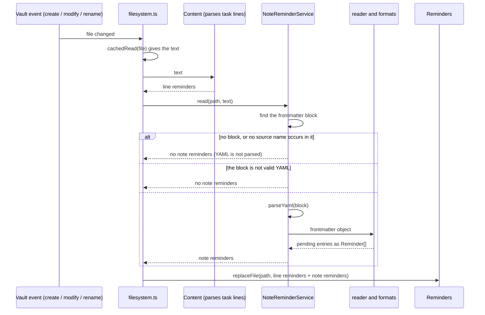
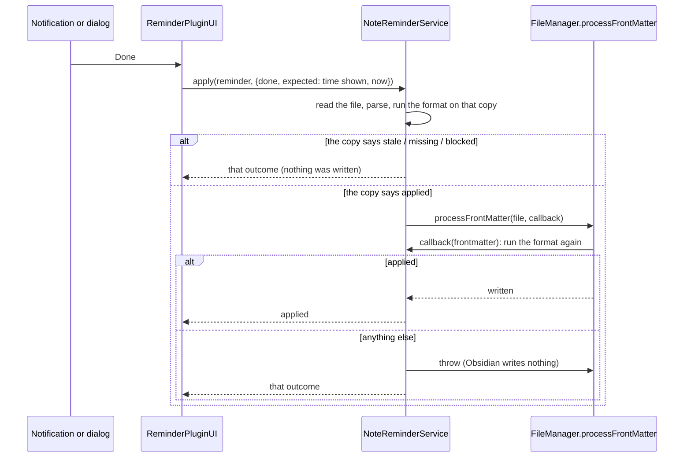

# Note-level reminders (reminders from properties)

*   **Author:** uphy
*   **Status:** First release implemented on the branch `note-reminder-spec`; second and third releases proposed
*   **Date:** 2026-11-14

## Overview

Today a reminder is a task line with a date. This design adds note reminders: a
reminder that belongs to a note, whose time is a property in the note's
frontmatter and whose title is the note's name unless the user sets one.

In the settings, the user lists the properties to read. Each listed property
that holds a date or a date-time becomes one reminder. "Done" and "Remind me
later" work from every place a reminder is shown today, and both write to the
note. A dialog, a command, a file-menu item and a bell in the note header let
the user create and edit a reminder without typing frontmatter.

The work ships in this order:

1.  Three fixes to existing code that the feature would otherwise make worse
    (section 13 of the Technical Plan).
2.  First release: plain properties, with the dialog and the bell.
3.  Second release: recurrence.
4.  Third release: the `reminders` list that the TaskNotes plugin keeps in its
    task notes.

This document specifies all of it. The Detailed Implementation Plan covers the
fixes and the first release, and names the files where the later releases
attach.

### Terms

*   **Line reminder**: what the plugin has today, a task line with a date.
*   **Note reminder**: the new kind, read from a property.
*   **Source**: one thing the user configured to be read: a property name (a
    row in the settings), or TaskNotes.
*   **Managed property / external property**: every source row is one or the
    other. A managed property is one the dialog may create, edit and remove.
    An external property is one whose value the user, Obsidian Bases or another
    plugin writes; this plugin reads it, records "Done" next to it, and moves
    its date on "Remind me later". It never creates or removes the value.
*   **Companion properties**: the properties this plugin keeps next to a
    property `p`: `p-done`, and for managed properties `p-title`, `p-repeat`
    and `p-occurrence`.
*   **Cut-off**: a date per source (`since` in the settings type). A value
    dated before it is not read.
*   **Pending**: a reminder that exists and has not been handled. Defined
    exactly in section 1 of the Technical Plan.
*   **Snooze**: the "Remind me later" action.
*   **Mute**: an existing per-reminder flag. The plugin sets it when it shows a
    reminder, so the periodic check (every 5 seconds by default) does not show
    it again. "Done" and snooze change the note, which removes or moves the
    reminder. The "Mute" button and closing a notification leave the flag set.
    Mute flags are saved in `data.json`. Mute is not "done": the reminder stays
    overdue in the reminder list.
*   **Origin**: where a reminder comes from: a line number, or a format and a
    key inside the note. Its **label** is the short text shown to the user
    (`follow-up`).
*   **Note reminder format** (short: format): the code that reads and writes
    one way of keeping reminders in frontmatter, as a line format does for
    task lines. There are two: plain
    properties, and TaskNotes.
*   **The spike**: a throwaway implementation on the local branch
    `spike/note-reminders`. It is evidence, not the change to merge.
*   **Verified**: observed by the author with the spike in a test vault. The
    Evidence section says what was run and how.

## The Problem

Three requests ask for a reminder that is not a task line:

*   A user keeps a "next follow-up" date as a column of a table in Bases
    (Obsidian's built-in database view over note properties) and wants to be
    reminded from it
    ([uphy/obsidian-reminder#268](https://github.com/uphy/obsidian-reminder/issues/268)).
*   The Spaced Repetition plugin writes a note's next review date into the
    `sr-due` property. A user wants that date to remind
    ([uphy/obsidian-reminder#28](https://github.com/uphy/obsidian-reminder/issues/28)).
*   The TaskNotes plugin keeps each task as a note and its reminders as a list
    in the note's `reminders` property. A contributor wants those in this
    plugin's notifications, with snooze
    ([uphy/obsidian-reminder#409](https://github.com/uphy/obsidian-reminder/pull/409)).

The plugin cannot serve them today for three reasons.

**It only reads lines.** A reminder is found by parsing one line of the note's
body and is identified by its line number. Frontmatter is never read.

**A property has nowhere to record "done".** A task line has a checkbox. "Done"
checks it and the reminder stops. A date property has nothing of the kind. The
pull request for TaskNotes kept the record in the plugin's `data.json`. That
breaks a rule this plugin holds: the note says what is due and what is done,
and `data.json` holds only settings, a cache that a rescan rebuilds, mute flags
and the do-not-disturb end time. With the record in `data.json`, the note and
the plugin can disagree, and a device that does not sync `data.json` notifies
again for everything.

**The values are written by someone else.** A Bases column is edited by the
user. `sr-due` and TaskNotes' entries are rewritten by another plugin on its
own schedule. "Done" must not delete or change such a value, and a value that
changes underneath an open notification must not be marked as handled by
mistake.

The design answers these with one rule: "Done" does not edit the value. It
writes the value it was notified about into `<property>-done`, and a reminder
is pending while the two differ. When the user or another plugin writes a new
date, the two differ again and the reminder is pending again with no other
edit.

Snooze is different from "Done": it is the user asking for the date to move, so
it rewrites the value, as the user would by hand in the table.

## Goals

First release:

*   A configured property that holds a date or a date-time produces a reminder
    in every place a line reminder appears: the in-app notification (toast or
    modal), the system notification, ntfy, and the reminder list.
*   "Done" and snooze on a note reminder write only to the note's frontmatter.
    With unchanged settings and notes, a full rescan gives the same pending
    reminders.
*   "Done" never changes the reminded value. It works on a property written by
    the user, by Bases, or by another plugin.
*   "Done" or snooze on a notification whose value has since changed in the
    note writes nothing.
*   Upgrading adds no note reminder to an existing vault until the user adds a
    source.
*   Adding a source whose property already holds past dates across the vault
    produces no notification for dates before a cut-off the user can see and
    edit.
*   A user can create, edit, complete and remove a reminder on a managed
    property from a dialog, and can see from the note header that the note has
    a pending one.
*   Line reminders keep their format, their keys, their mute flags and their
    scheduled ntfy messages. The only behaviour changes to them are the three
    fixes in section 13.

Second release:

*   A reminder on a managed property can repeat. "Done" moves it to the next
    occurrence, and a snooze does not shift the series.

Third release:

*   TaskNotes `reminders` entries produce reminders with "Done" and snooze. The
    feature is off by default. Entries that TaskNotes wrote are never changed.

Across releases:

*   The code that knows one way of keeping reminders in frontmatter (a note
    reminder format) is separate from the
    code that schedules, notifies and writes. Adding the TaskNotes format
    changes no file outside its own, the settings and the plugin's wiring.

## Non-Goals

*   A list of dates in one property. None of the three requests needs it. A
    note with several reminders can use task lines.
*   Changing how Obsidian's properties panel or a Bases cell looks. Obsidian
    offers no supported way to do it.
*   Creating, editing or removing the value of an external property from the
    dialog.
*   Showing "done" as a checkbox in the properties panel. The state is "`p`
    and `p-done` hold the same date". A Bases formula column, the header bell
    and the reminder list show it.
*   Values with a UTC offset or `Z` (`2026-11-20T09:00:00+09:00`). They are not
    read. Obsidian's property editor does not write them.
*   Reading a property's type from Obsidian. There is no public API for it.
*   Reading TaskNotes' settings or calling its internal functions; TaskNotes
    recurring tasks; completing a TaskNotes task from a notification;
    suppressing TaskNotes' own notifications.
*   A public API for formats written by third parties.
*   Preserving YAML comments, quoting and inline list style when the plugin
    writes to a note's frontmatter (see Risks & Mitigations).
*   Ordering or guarding line writes beyond what exists today (see section
    13).

## Open Questions

*   **Phone layout of the dialog (first release).** Under Obsidian's mobile
    emulation at tablet width the calendar is centred and the action row stays
    in view. Nothing was run at phone width or on a device. To check on a
    phone before the first release ships.
*   **Recurrence: a hand edit after a snooze (second release).** As specified
    in section 11, `p-occurrence` survives when the user edits `p` by hand
    after a snooze, so the next "Done" continues the series from the old
    occurrence instead of the edited date. Proposed fix: format the snoozed-to
    time with the occurrence and use the occurrence only while `p` still
    equals it. To settle before the second release is implemented.
*   **Recurrence: the next occurrence can equal the time just completed
    (second release).** With `start` = `p-occurrence`, `nextOccurrence` can
    return the snoozed time itself (a daily reminder snoozed to tomorrow and
    completed today), which would then count as done. Proposed fix: require
    the next occurrence to be after the time shown. To settle with the
    previous point.
*   **TaskNotes: leftover snooze entries (third release).** Section 12 removes
    a no-longer-valid entry "on the next write", which may never come, and
    does not say what a snooze does while such an entry exists. Proposed fix:
    every write first removes the plugin's invalid entries, and a snooze
    replaces an existing entry for the same original. To settle before the
    third release is implemented.

## Critical User Journeys (CUJs)

### CUJ 1: A Bases follow-up date reminds and is pending again after an edit

*   **Given**: `follow-up` is configured as an external property with a cut-off
    of today. A note has `follow-up: 2026-11-20`.
*   **When**: November 20 arrives at the time in the "Reminder Time" setting.
    The user presses "Done". A week later the user types `2026-12-05` into the
    Bases cell.
*   **Then**: A notification shows the note name with "follow-up · 2026-11-20".
    After "Done" the note has `follow-up: 2026-11-20` and
    `follow-up-done: 2026-11-20`, and nothing more is shown. After the edit the
    note reminds on December 5 with no other step.

### CUJ 2: A reminder set from the dialog

*   **Given**: No source is configured. A note has no frontmatter.
*   **When**: The user runs "Set reminder for this note". A prompt offers to use
    the property `reminder`; the user accepts. In the dialog the user picks
    tomorrow 09:00, types the title "Send the report", and presses "OK".
*   **Then**: The settings have a managed row `reminder` with today as its
    cut-off. The note has `reminder: <tomorrow>T09:00:00` and
    `reminder-title: Send the report`. A bell appears in the note header. At
    09:00 the notification is titled "Send the report". After "Done" the bell
    turns faint.

### CUJ 3: Another plugin moves the date under an open notification

*   **Given**: `sr-due` is an external property. A system notification for
    `sr-due: 2026-11-20` is on screen.
*   **When**: The user reviews the note in Spaced Repetition, which rewrites
    `sr-due` to `2026-11-27`. The user then presses "Done" on the old
    notification.
*   **Then**: Nothing is written. The note reminds on November 27.

### CUJ 4: Adding a source with years of past dates

*   **Given**: 300 notes have a `follow-up` date in the past. No source is
    configured.
*   **When**: The user adds `follow-up` in the settings today.
*   **Then**: The new row's cut-off is today and the row says "300 earlier
    values in the vault are ignored". No notification is shown for them. A note
    whose `follow-up` is set to next week reminds next week.

### CUJ 5: Snoozing a date-only reminder

*   **Given**: The reminder for `follow-up: 2026-11-20` is shown.
*   **When**: The user opens the snooze list.
*   **Then**: Only the options whose result is a whole day ("Tomorrow", "Next
    week") are listed. Choosing "Tomorrow" writes `follow-up: 2026-11-21`,
    still a date, so the Bases column keeps showing a date.

### CUJ 6: Upgrade without configuration

*   **Given**: A vault with line reminders, some muted and some scheduled on
    ntfy, and notes that happen to have a `reminder` property.
*   **When**: The plugin is upgraded.
*   **Then**: No note reminder exists. The mute flags and ntfy messages of the
    line reminders are unchanged.

### CUJ 7: "Done" blocked by the user's own column

*   **Given**: `follow-up` is an external property. The vault already has a
    checkbox column named `follow-up-done`, and a note has
    `follow-up: 2026-11-20` and `follow-up-done: true`.
*   **When**: The reminder is shown and the user presses "Done".
*   **Then**: Nothing is written. A notice names `follow-up-done`. The reminder
    stays overdue in the reminder list and is not shown again in this session.
    The settings row for `follow-up` warns about the column.

### CUJ 8 (second release): A monthly reminder that was snoozed

*   **Given**: A managed property with `reminder: 2026-11-20T09:00:00` and
    `reminder-repeat: every month`.
*   **When**: On November 20 the user snoozes it by 30 minutes, then presses
    "Done" at 09:40. On December 20 the user presses "Done" at 09:05.
*   **Then**: After the snooze the note has `reminder: 2026-11-20T09:30:00` and
    `reminder-occurrence: 2026-11-20T09:00:00`. After the first "Done" it has
    `reminder: 2026-12-20T09:00:00`, `reminder-done: 2026-11-20T09:30:00` and
    no `reminder-occurrence`. After the second "Done" it has
    `reminder: 2027-01-20T09:00:00`.

### CUJ 9 (third release): A TaskNotes reminder relative to the due date

*   **Given**: TaskNotes reading is on. A task note has `due: 2026-11-20T10:00`
    and one `reminders` entry meaning "15 minutes before due".
*   **When**: 09:45 arrives and the user presses "Done". Later the user moves
    `due` to November 27 in TaskNotes.
*   **Then**: The entry is unchanged and `reminders-done` holds the entry's id
    with the time it was shown for. After `due` moves, the same entry reminds
    at 09:45 on November 27.

## Technical Plan (Architecture)

### 1. What is stored in the note

For a source property `p`:

| Property | Holds | Written by |
| --- | --- | --- |
| `p` | The time. Empty means nothing is scheduled. | The user, Bases, another plugin; this plugin on snooze, in the dialog, and on a repeating "Done" |
| `p-done` | The value of `p` that "Done" was last pressed for. | This plugin |
| `p-title` | A title. Managed properties only. | The dialog, or the user |
| `p-repeat` | A recurrence rule. Managed properties only. Second release. | The dialog, or the user |
| `p-occurrence` | The occurrence a snooze postponed. Exists only between a snooze and the next "Done" on a repeating reminder. Second release. | This plugin |

**Time values.** A value is a time when it is a string in one of two shapes:

*   a date, `YYYY-MM-DD`;
*   a date-time, `YYYY-MM-DD`, then `T` or one space, then `HH:mm` or
    `HH:mm:ss`.

Leading and trailing spaces are ignored. Seconds are dropped when the value is
read. Anything else is not a time: other text, a value with `Z`, a UTC offset
or fractional seconds, a number, a list, a checkbox. A date and a date-time are
different values, also at midnight. Two times are **equal** when they have the
same shape and the same minute.

The plugin writes `YYYY-MM-DD` for a date and `YYYY-MM-DDTHH:mm:00` for a
date-time, which is what Obsidian's property editor writes.

**Pending and notifying.** A reminder is pending when `p` is a time, that time
is on or after the source's cut-off day, and `p-done` is not a time equal to
it. A pending reminder is shown once its time has passed and it is not muted.
A date counts as passed at the time in the "Reminder Time" setting on that day,
as for date-only task lines.

**What each action writes.**

| Action | Applies to | Checks first | Writes |
| --- | --- | --- | --- |
| Done | every source | stale check; `p-done` check | `p-done` = the time shown |
| Snooze | every source | stale check; the new time differs from the value in `p` | `p` = the new time in the shape of the old value; removes `p-done` if it equals the new time |
| Dialog: OK | managed | `p` is empty or a time | `p` = the chosen time; sets or removes `p-title`; removes `p-done` if the time was changed and `p-done` equals the new time |
| Dialog: Mark as Done | managed | stale check; `p-done` check | as Done |
| Dialog: Remind again | managed | `p-done` equals `p` | removes `p-done` |
| Dialog: Remove | managed | `p` is a time | removes `p` and `p-title`; removes `p-done` if it is empty or a time |

*   **Stale check.** "Done" and snooze carry the time the notification (or the
    dialog) was showing. If `p` is no longer equal to that time, or the
    reminder is already done, nothing is written.
*   **`p-done` check.** If `p-done` exists and is neither empty nor a time (the
    user already had a checkbox or text column under that name), "Done" writes
    nothing. No action ever changes or removes such a value.
*   A `p-title` that is not text is treated as absent when read and is left
    untouched by the dialog.
*   Snooze removes an equal `p-done` because otherwise the user's chosen time
    would count as handled and never be shown.
*   A date-time reminder snoozed with a whole-day option ("Tomorrow") gets the
    "Reminder Time" setting as its time. The notification handler computes
    that time before it calls the format (`snoozeTimeFor` in `value.ts`); the
    format only keeps the shape. A date reminder is only offered whole-day
    options (section 7).
*   "OK" with an unchanged time keeps `p-done`, so editing only the title of
    a finished reminder does not make it pending again. "Remind again" is the
    explicit way to do that.

**Limits that follow from the rule.** After "Done", writing the same date into
`p` again does not make the reminder pending. To be reminded for the same date
the user removes `p-done` in the properties panel, or, for a managed property,
presses "Remind again" in the dialog. "Done" on an external property is undone the same
way.

### 2. Layers

```text
 src/model/note/           pure: no import of the obsidian module, unit-tested
 ┌───────────────────────────────────────────────────────────────┐
 │ value.ts          parse, format and compare a time value      │
 │ sources.ts        the source row type and its validation      │
 │ format.ts         the format interface and the outcome type   │
 │ property-format.ts plain properties                           │
 │ tasknotes-format.ts TaskNotes entries (third release)         │
 │ reader.ts         frontmatter object -> Reminder[];           │
 │                   routes an action to the format of a reminder│
 └───────────────────────────────────────────────────────────────┘
 src/plugin/               depends on Obsidian
 ┌───────────────────────────────────────────────────────────────┐
 │ note-reminders.ts NoteReminderService: finds the frontmatter  │
 │                   block, parses YAML, writes through          │
 │                   FileManager.processFrontMatter              │
 │ filesystem.ts     merges line and note reminders per file     │
 │ ui/               dialog, header bell, notifications          │
 └───────────────────────────────────────────────────────────────┘
```

The format interface (types, not code to copy):

```ts
type Frontmatter = Record<string, unknown>;

type NoteReminderEntry = {
  key: string;      // identifies the reminder inside the note: the property
                    // name, or a TaskNotes entry id
  time: DateTime;
  title?: string;   // absent: the note name is used
  label: string;    // shown to the user as the origin, e.g. "follow-up"
};

type NoteReminderAction =
  | { type: "done"; expected: DateTime; now: DateTime }
  | { type: "snooze"; expected: DateTime; time: DateTime };

type ApplyOutcome =
  | "applied"   // the frontmatter object was changed
  | "unchanged" // a snooze chose the time the reminder already has
  | "stale"     // the reminder exists but is not pending at `expected`
  | "missing"   // the reminder is gone
  | "blocked";  // the `p-done` check failed

interface NoteReminderFormat {
  readonly id: string;                  // "property" | "tasknotes"
  keys(): string[];                     // names to look for in the YAML text
  read(fm: Frontmatter): NoteReminderEntry[];   // pending entries
  apply(fm: Frontmatter, key: string, action: NoteReminderAction): ApplyOutcome;
}
```

`apply` leaves the object untouched unless it returns `applied`. A format
applies its own cut-off in `read`, because the property format has one per row
and the TaskNotes format has one for the whole format.

The dialog's read, create, edit, re-arm and remove are functions exported by
`property-format.ts` (`readPropertyReminderState`, `pickInitialProperty`,
`setPropertyReminder`, `rearmPropertyReminder`, `removePropertyReminder`). The
three that write return an `ApplyOutcome`, so the dialog passes them to the
service's `write` as it passes a format action. They are not part of the
interface, so the TaskNotes format does not have to answer for them.

The service adds one result that no format returns:

```ts
type WriteResult = ApplyOutcome | "failed";   // failed: the note could not be
                                              // read or written at all
```

The interface was run with both formats on the spike: the TaskNotes format was
added without changing the reader or the service.

### 3. The reminder model

`Reminder.rowNumber` is replaced by an origin:

```ts
type ReminderOrigin =
  | { kind: "line"; row: number }
  | { kind: "note"; format: string; key: string; label: string };
```

*   `Reminder.key()` identifies a reminder for mute flags and open
    notifications. For a line reminder it stays `file + title + time`, byte for
    byte, so saved mute flags keep matching. For a note reminder it is file,
    format, key-in-note and time, joined by the character U+0001. The title is
    not part of it, so editing `p-title` does not unmute.
*   `Reminder.equals()` decides whether a reload changed anything. For a note
    reminder it compares file, format, key-in-note, label, title and time, so a
    title edit refreshes the list.
*   Code that needs a line asks for it through `row(): number | undefined`: the
    editor pill (the date chip drawn on a task line in the editor), the
    toggle-checklist command, the line rewrite in `reminder-base.ts`, and the
    jump to the line after opening a note. The compiler finds every such place
    because `rowNumber` no longer exists. The spike kept `rowNumber` with `-1`
    for note reminders, and one consumer (the ntfy id) was missed until a
    reviewer read every use.

### 4. Reading



*   **The service reads the file's text, not Obsidian's metadata cache.**
    Verified: inside a `modify` handler,
    `metadataCache.getFileCache(file).frontmatter` still returned the value
    from before the edit. The plugin reloads a file on `modify`, so a cache
    read there would bring a just-handled reminder back.
*   The frontmatter block is the text between a first line that is exactly
    `---` and the next line that is `---` followed only by spaces. YAML is
    parsed only when the block's text contains one of the names from
    `format.keys()`. Verified: Obsidian's `parseYaml` returns `2026-11-20` and
    `2026-11-20T09:00:00` as strings.
*   `replaceFile` is called once per file with both kinds of reminder, because
    a second call would replace the first one's reminders.
*   While a note's frontmatter is not valid YAML (a half-typed edit in source
    mode) the note has no note reminders. When it is valid again, an overdue
    reminder is shown again because its mute flag left with it. Editing a
    property through Obsidian's own controls never produces invalid YAML.
*   Task-line parsing is unchanged. It does not skip the frontmatter block
    today and will not after this change.

### 5. Writing



*   `FileManager.processFrontMatter` reads, changes and saves the frontmatter
    in one step, so two actions on one note cannot overwrite each other, and
    neither can an edit by Obsidian's property editor. No queue is needed.
*   The format runs twice. Verified: `processFrontMatter` rewrites the block,
    dropping comments and quotes, even when the callback changes nothing, and
    it writes nothing when the callback throws. So the first run on a copy
    avoids entering `processFrontMatter` for an action that will not write, and
    in the callback any outcome other than `applied` is turned into a thrown
    marker that the service catches.
*   A thrown error of any other kind (file missing, YAML that Obsidian cannot
    parse) gives `failed`.
*   **The time shown is captured when the notification is created**, and that
    value is `expected`. The existing snooze handler assigns the new time to
    the shared `Reminder` object before writing; for a note reminder it must
    not, or a second surface showing the same reminder would pass the snoozed
    time as `expected`.
*   What the UI does with the result:

| Result | UI |
| --- | --- |
| `applied` | Nothing. Verified: the write emits `modify`, the file is reloaded, and the reminder leaves the list or moves. |
| `unchanged` | Nothing is written and the reminder is unmuted, so it is shown again like a snoozed line reminder whose time did not move. Example: "Next Saturday" chosen on a Saturday for a date-only value. |
| `stale`, `missing` | The file is reloaded. No notice. |
| `blocked` | A notice names the `p-done` property. The reminder stays muted and overdue in the list. |
| `failed` | A notice names the note. The reminder stays muted and overdue in the list. |

Leaving the reminder muted after `blocked` and `failed` is deliberate: the
periodic check shows every unmuted overdue reminder, so unmuting would bring
the same notification back within seconds for a cause the user has to fix in
the note first.

### 6. Sources and the cut-off

A new setting, `noteReminderSources`, holds a list of rows:

```ts
type NoteReminderSource = {
  property: string;   // e.g. "follow-up"
  managed: boolean;   // false: external
  since: string;      // the cut-off, "YYYY-MM-DD"; "" means none
};
```

*   The list is empty by default. With an empty list `keys()` is empty and no
    note's YAML is parsed.
*   A value dated before `since` is not read. A value dated on that day is.
*   Adding a row sets `managed` to false. `since` is today when the vault
    already holds values of the property dated before today, and empty
    otherwise: the cut-off exists to stop those values from notifying at
    once, and a date with nothing to hide only raises a question. The check
    covers every note, also under an excluded path (its values are read once
    the path is no longer excluded), and when Obsidian has not indexed every
    note yet the answer is today. Only the user changes `since` afterwards.
*   The setting is tagged like the other settings that change what is parsed,
    so a change triggers a full rescan.
*   A name is rejected when it is empty, when it is already listed, or when it
    is a companion name of another row or the other row's name is a companion
    of it (`follow-up-done` next to `follow-up`).

The settings page has a new tab "Note reminders" (verified layout, see
Evidence):

*   One line with a text field and an "Add" button, with the validation message
    under it.
*   Below it, one bordered box per source, so that it is clear which
    settings belong to which property. The title line has the property name,
    a warning when some note has a `p-done` that is not a time, and a remove
    button. Under it, each setting has its own line with a name and a
    description, which leaves room for more settings: "Managed" (a switch),
    and "Ignore dates before" (a date input for the cut-off, with "N earlier
    values in the vault are ignored" when N > 0).
*   The two counts are display-only. They are computed when the tab is drawn,
    from Obsidian's metadata cache, by a function the plugin gives to the
    settings object. The settings code itself does not reach Obsidian's `app`.
*   The settings builder has no list type. It gets one new kind, `custom`,
    which takes an initial value and a function that draws the controls and
    writes the value. The source rows are the only user of it.

The cut-off is a setting of the same nature as "excluded paths": it decides
what is read, a rescan with the same settings gives the same reminders, and
devices must share `data.json` to agree. Its limits are listed under Risks &
Mitigations.

### 7. Snooze options and value shape

*   The snooze list comes from the existing "Remind me later" setting. For a
    date-only note reminder, only the options whose result has no time part
    are offered. With the default list those are "Tomorrow" and "Next week";
    "In 30 minutes", "In 1 hour" and "In 3 hours" produce a time and are left
    out. When none is left, the snooze control is hidden.
*   A snooze never changes a value's shape.
*   The dialog uses the existing calendar and time chooser unchanged. Leaving
    the time empty gives a date and picking a time gives a date-time. With an
    existing value the chooser starts from it.
*   Obsidian has one type per property name for the whole vault, taken from the
    first value written. Verified: a date-time in a property typed "date" is
    shown as raw text in the properties panel and in Bases, and a date in a
    property typed "date & time" is shown with `00:00`. The plugin does not
    read or set the type. For external properties this cannot go wrong, since a
    snooze keeps the shape. For a managed property the user chooses the shape
    in the dialog; the documentation states the limit.

### 8. User interface

*   **Command "Set reminder for this note"**, and the same item in the file
    menu of a Markdown file. The command acts on the active note, the menu item
    on the file that was clicked. Both are unavailable for a note under an
    excluded path, because its reminders are not read.
    *   With no managed row, a prompt explains that note reminders are kept in
        a property and offers to use `reminder`. Accepting adds the row as
        managed, with the same cut-off rule as a row added in the settings
        (or switches an existing `reminder` row to managed), then opens the
        dialog.
*   **Dialog.** It reads the note's text through the service when it opens.
    From top to bottom:
    *   A heading, "Reminder for <note name>".
    *   A status line when the property holds a time: "Scheduled: <time>",
        "Done: <time>", or "Not shown (before the cut-off): <time>".
    *   A property dropdown when there are several managed rows. Preselected:
        the first row with a pending reminder, else the first row with a time,
        else the first row.
    *   A title field. Its placeholder is the note name.
    *   The existing calendar and time chooser. Its "OK" saves and closes. With
        no existing value it starts at the chooser's usual default.
    *   When the property holds a time: "Remove reminder" on the left; on the
        right "Mark as Done" when the reminder is pending, or "Remind again"
        when it is done.
    *   When the property holds a value that is not a time: a message showing
        the value, and no chooser and no buttons.
    *   Every button closes the dialog. A result of `blocked` or `failed` then
        shows a notice.
    *   When the chosen time is before the row's cut-off, a notice says the
        reminder was saved but will not be shown, and names the setting.
    *   The dialog closes when the plugin is unloaded.
    *   The calendar is centred in a dialog wider than it. On mobile the
        action row is sticky at the bottom of the dialog, so it stays in view
        while the content scrolls (see Open Questions).
*   **Header bell.** A view action in the header of a Markdown view. Clicking
    opens the dialog. It has three states: a ringing bell for a note with a
    pending reminder on a managed property (its tooltip lists the time and
    the property); a faint bell for a note that holds a time in a managed
    property that is not pending (done, or before the cut-off); a faint bell
    with a plus for a note with none. The two faint states exist so that the
    way to add a note reminder is on screen and not only in the command
    palette and the file menu. They are shown when at least one property is
    managed and the "Show a bell in every note's header" setting is on
    (default); with it off only the ringing bell is shown. The file-menu item
    follows the same distinction: "Set reminder for this note" or "Edit this
    note's reminder". The command keeps one name, because a command's name
    is not evaluated per note. The set of bells is refreshed when reminders,
    a note's properties or the setting change and when a view shows another
    file, coalesced because a full rescan reports a change per file. Bells
    are removed on unload.
*   **Notifications.**
    *   Toast and modal: under the title, one line "<label> · <time>". The file
        button below it stays. Clicking it opens the note without a line jump.
        The Alt+S shortcut does nothing when the snooze control is hidden.
    *   System notification: the body is the title, a line break, and the
        label.
    *   ntfy: the message title is the reminder's title; the message text is
        "<note name> · <label>" (today it is the note name).
*   **Reminder list.** Note reminders appear among line reminders with a note
    icon, and the label after the note name. Dragging one into a note inserts
    a link to the note, preceded by the title and " - " when the note has a
    `p-title` (told by the title differing from the note name). When the
    title is the note name, the list shows the label alone instead of
    repeating the name. The tooltip is unchanged.
*   **Calendar popup for task lines** (opened by the `(@` trigger and the pill).
    Its behaviour is unchanged. The list of the selected day's reminders at its
    bottom shows note reminders too, since it lists everything due that day.
*   **Editor pill, autocomplete.** Unchanged. They see line reminders only.

### 9. Cache in `data.json`

Note reminders are cached under a new top-level key, `noteReminders`:
`{ [file]: { format, key, label, title, time, muted }[] }`. Line reminders keep
the `reminders` key and its shape.

*   On load, the two lists of a file are merged before the single
    `replaceFile` call. The "re-notify muted on startup" setting applies to
    both.
*   On save, reminders are split by origin kind. `reminders` never contains a
    note reminder, so an older plugin version cannot load one as a line
    reminder.

### 10. ntfy

The plugin schedules a message on an ntfy server per pending reminder, under an
id derived from the reminder, so that publishing again under the same id
replaces the message and a message whose reminder is gone can be deleted. Today
the id is `obr-` plus a hash of file and title, plus an index (by row order)
for reminders that share both.

*   A note reminder's id is `obrn-` plus the same two hashes computed over
    `file`, format, key-in-note and title, joined by line breaks. It takes no
    index. A snooze changes the time, which republishes under the same id. A
    title change gives a new id: the old message is deleted as an orphan and a
    new one is published, with the existing sync plan unchanged.
*   Line reminders keep their ids.
*   Turning ntfy off deletes the device's pending `obr-` and `obrn-` messages
    alike.
*   A device deletes orphaned `obrn-` messages only when it has at least one
    source configured (a row, or TaskNotes reading), or had one earlier in the
    same session, so that removing the last source still cleans up. A message
    scheduled before a restart that followed the removal stays until it fires;
    messages are scheduled at most 24 hours ahead. Otherwise a device that
    does not use note reminders would delete the messages another device
    scheduled. Devices that both use note reminders must have the same rows and
    cut-offs, as they must already share the other settings that decide what is
    parsed.

### 11. Recurrence (second release)

*   `p-repeat` holds the natural-language rule the task-line formats accept
    after 🔁 (`every month`, `every week on Monday`), parsed by the existing
    `nextOccurrence(rule, start, now)` in `model/format/recurrence.ts`. That
    function steps the series from `start`, skips occurrences that are already
    past `now`, and supports the `when done` suffix. Note reminders behave the
    same as line reminders in all three respects.
*   On "Done": `p-done` = the time shown; `p` = `nextOccurrence(rule, start,
    now)` with `start` = `p-occurrence` if it is a time, else the time shown;
    `p-occurrence` is removed.
*   On snooze, when `p-repeat` is set and `p-occurrence` is not a time:
    `p-occurrence` = the time shown. Then `p` = the new time. A second snooze
    keeps the first `p-occurrence`.
*   "OK" in the dialog removes `p-occurrence`: a time chosen there starts the
    series from that time. An edit of `p` by hand has no `p-occurrence` either,
    so it also restarts the series from the new time.
*   A rule that cannot be parsed: "Done" records `p-done`, leaves `p`, and a
    notice says the rule was not understood. The dialog validates the rule as
    the user types. A rule that has ended (an `until` date in the past)
    completes without a notice. The two are told apart by parsing the rule
    separately from computing the next occurrence.
*   `p-repeat` and `p-occurrence` are ignored on external properties.
*   Attach points: the "done" and "snooze" branches of the property format, and
    one field in the dialog.

Verified on the spike, in the format's unit tests: the sequence of CUJ 8,
including the second cycle.

### 12. TaskNotes (third release)

TaskNotes 4.x keeps a task as a note. The parts of its frontmatter this design
uses, as observed with TaskNotes 4.18.2:

```yaml
tags: [task]
status: open                # "done" when completed
due: 2026-11-20T10:00
scheduled: 2026-11-19
recurrence: ...             # present on a recurring task
reminders:
  - id: rem_1
    type: relative          # fires at <relatedTo> plus <offset>
    relatedTo: due          # "due" or "scheduled"
    offset: -PT15M          # ISO 8601 duration
    description: 15 min before
  - id: rem_2
    type: absolute          # fires at <absoluteTime>
    absoluteTime: 2026-11-18T09:00:00
```

The **effective time** of an entry is `absoluteTime` for an absolute entry, and
the value of the property named by `relatedTo` plus `offset` for a relative
one. A date-only base counts from midnight.

*   A second format, `tasknotes`, with its own settings group: a switch (off by
    default), the task tag (default `task`), the statuses that mean completed
    (default `done`), and a cut-off date that is set to today when the switch
    is turned on with the cut-off empty. Only TaskNotes' default property names
    are supported; the settings description says so.
*   Read: a note that has the tag, whose status is not a completed one, that
    does not have the tag `archived`, and that has no `recurrence`. Each entry
    with an id and an effective time on or after the cut-off is a reminder,
    unless `reminders-done` holds its record. An entry of another type, or
    whose time cannot be computed, is skipped. If `reminders` contains anything
    that is not a mapping, the note yields nothing and is never written.
*   "Done" appends `<id>@<effective time>` to the list property
    `reminders-done`, replacing an older record of the same id. Records whose
    entry no longer exists are dropped in the same write. Entries are not
    changed.
*   Snooze records the entry as done and adds one entry of its own to
    `reminders`: `type: absolute`, the chosen time, the id
    `obsidian-reminder-snooze-<original id>`, and the original description.
    This is the only change the plugin makes to `reminders`. An entry counts as
    the plugin's own only with that id prefix and `type: absolute`. A second
    snooze rewrites its time; "Done" on it removes it.
*   The added entry is used only while `reminders-done` holds its original's
    record at the original's current effective time. Otherwise (the due date
    moved, or the original was deleted) it is ignored and removed on the next
    write.
*   The stale check compares the entry's effective time with the time shown.
*   Not solved, by design: TaskNotes notifies for the same entries itself,
    including the added one. Verified that with its notifications on, both
    plugins notify, and "Done" here does not dismiss TaskNotes' notice. The
    settings description tells the user to turn one of the two off.
*   The dialog and the bell do not apply to TaskNotes notes.

Verified on the spike with TaskNotes 4.18.2: TaskNotes lists the added entry
among the task's reminders, and keeps `reminders-done` and the added entry when
it rewrites `due` and `priority`.

### 13. Fixes to existing code

Each ships as its own change before the first release.

1.  **Lost save.** Today: `PluginData.save()` clears its `changed` flag after
    the asynchronous write, so a change that arrives during the write is never
    saved. On the spike this left a handled note reminder in `data.json`. Fix:
    clear the flag before the write; set it again if the write throws, and
    rethrow as today.
2.  **A full rescan forgets every mute flag and closes every open
    notification.** Today: `reloadRemindersInAllFiles()` calls
    `Reminders.clear()` and then reloads each file, so reminders come back
    unmuted and are shown again. A change to any setting that affects parsing
    triggers it, and adding a source will too. Fix: do not clear. Reload each
    Markdown file through the existing per-file path, which carries mute flags
    over by key, then remove the entries of files that no longer exist or are
    excluded.
3.  **Blank time field.** Today: the time picker shows an empty field for a
    time that is not on the configured step (09:25 with a 15-minute step),
    here and in the existing calendar popup. Fix: add the current value to the
    options.

**Not changed: line writes.** Line "Done" and snooze read the whole file and
write it back in two steps, and find the task by row number. A frontmatter
write that lands between the two steps would be overwritten. That needs two
actions on one note within the few milliseconds between the read and the write,
which a person cannot produce from the UI. Making line writes atomic means
turning the asynchronous format code synchronous, which is outside this design.

## Risks & Mitigations

*   **A write reformats the note's frontmatter.** Obsidian's frontmatter API
    rewrites the whole block: YAML comments are dropped, quotes around plain
    strings are removed, `[a, b]` lists become block lists; key order is kept
    and new keys are appended (verified). This happens on "Done" and snooze,
    including on a note written by another tool. Mitigation: it is exactly what
    Obsidian does when the user edits any property in its panel or in Bases, so
    a note used with those is already in this form; the plugin never enters the
    API for an action that will not write (section 5); the user guide states
    it.
*   **The cut-off hides reminders the user may expect.** A value dated before
    `since` is never shown, also when it is written later. If `data.json` is
    lost, or a row is removed and added again, `since` becomes that day
    (the property has past values by then) and overdue reminders not yet
    marked done are hidden. For `sr-due`, the notes
    already overdue when the row is added are hidden. Mitigation: the cut-off
    is a visible date the user can move back; the row shows how many values it
    hides; the dialog warns when a chosen time is before it; the guide lists
    these cases. A Bases formula that shows state cannot know the cut-off; the
    guide says so.
*   **Rollback loses the rows.** An older plugin version saves only the
    settings it knows, so its first save drops `noteReminderSources` and the
    `noteReminders` cache. Notes keep their `-done` and other companion
    properties, which do nothing without the feature. After upgrading again the
    user adds the rows again and moves the cut-offs back if needed; nothing
    recorded as done is lost, because that record is in the notes.
*   **Devices that disagree.** Two devices with different rows or cut-offs show
    different reminders and, with ntfy, delete each other's scheduled messages.
    Mitigation: section 10 keeps a device without sources from touching
    note-reminder messages; the guide says devices must share the settings.
*   **Another plugin drops the companion property.** If a plugin rewrote its
    note without keeping unknown properties, `p-done` would vanish and the
    reminder would be shown again. Verified not to happen with Spaced
    Repetition 1.15.4 (a review keeps `sr-due-done`) and TaskNotes 4.18.2. For
    another plugin the effect is a repeated notification, not data loss.
*   **The write guard depends on how Obsidian treats a throwing callback.**
    That `processFrontMatter` writes nothing when its callback throws was
    observed on Obsidian 1.15.0 only, while the plugin's minimum version is
    1.7.2. If an older version wrote anyway, the effect would be a reformatted
    but otherwise unchanged block, because the format changes nothing unless it
    returns `applied`.
*   **Obsidian or another plugin writes the note at the same moment.** The
    frontmatter API reads and writes in one step, and the format checks the
    value again inside it (section 5).
*   **Scale.** One run on the author's Mac, in a test vault of a few hundred
    notes plus 2,000 added notes of which 500 hold a reminder property, with
    three sources configured: a full rescan took about 0.6 s, against about
    0.07 s with no source. The cost is the YAML parse of notes whose
    frontmatter text contains a source name, about 1 ms each. Not measured on
    larger vaults; a property name that occurs in most notes of a very large
    vault makes each full rescan proportionally slower. The per-file reload on
    edit is unaffected.
*   **Mobile.** Only tablet-width emulation was run. See Open Questions.
*   **Security and privacy.** No new network call, permission or stored
    secret. With ntfy enabled, a note reminder sends the same kind of data as a
    line reminder does today (the title and the note name) plus the property
    name. A `p-title` is user-written text and is sent as the title.

## Alternatives Considered

### How "Done" is recorded

#### A1: A completion checkbox, or removing the value when none is configured

*   **Pros**: A checkbox reads as "done" in the properties panel and in Bases
    with no formula.
*   **Cons**: The checkbox is not tied to a date. After "Done", typing the next
    date leaves it checked and nothing is shown, with no error. Spaced
    Repetition never clears it. Removing the value deletes user data under a
    button labelled "Done" and takes `sr-due` out of the other plugin's
    schedule.
*   **Reason for Rejection**: Rejected by author: it fails silently on the main
    use, a date column the user keeps updating, and cannot be used on a
    property another plugin writes.

#### A2: A "handled through" date per property

*   **Pros**: One comparison, earlier or later.
*   **Cons**: Completing a later date marks every earlier date done. A date
    moved back in time never reminds.
*   **Reason for Rejection**: Rejected by author: users move a follow-up date
    in both directions.

#### A3: One list property holding every handled value of the note

*   **Pros**: One plugin property per note, however many properties remind.
*   **Cons**: A list cannot be compared with a date cell in a Bases formula,
    and the properties panel shows it as opaque strings.
*   **Reason for Rejection**: Rejected by author for plain properties, because
    a per-property date can be shown and compared in Bases. Used for TaskNotes
    (`reminders-done`), where entries have ids and are not Bases cells.

#### A4: A per-source setting that selects the "Done" behaviour

*   **Pros**: Each user picks what suits their column.
*   **Cons**: Three behaviours to implement, test and document, and the user
    must understand how each fails to choose one.
*   **Reason for Rejection**: Rejected by author: the `p-done` rule worked for
    a Bases column and for `sr-due` on the spike, so a choice would add cost
    without serving a case the rule does not.

#### A5: Done-state in `data.json`

*   **Pros**: No extra property in notes. This is what
    [uphy/obsidian-reminder#409](https://github.com/uphy/obsidian-reminder/pull/409)
    implemented.
*   **Cons**: The note and the plugin can disagree. A device that does not sync
    `data.json` notifies again for everything. A rescan cannot rebuild it.
*   **Reason for Rejection**: Rejected by author: it breaks the rule that the
    note is the only record of what is due and done, stated to the contributor
    in the
    [reply on the pull request](https://github.com/uphy/obsidian-reminder/pull/409#issuecomment-6866229732).

#### A6: "Done" acts on whatever value the note holds now

*   **Pros**: The action needs no `expected` argument and there is no `stale`
    outcome.
*   **Cons**: A notification left on screen marks a newer value as handled.
    After a Spaced Repetition review, "Done" on the old notification would
    silence the next review.
*   **Reason for Rejection**: Rejected by author: the spike worked this way at
    first, and the case above was found by reading its code.

### How snooze is written

#### B1: A plugin-owned snooze property, leaving `p` untouched

*   **Pros**: The plugin never rewrites a value it did not create.
*   **Cons**: The Bases column shows a date that is no longer when the reminder
    is shown. One more companion property.
*   **Reason for Rejection**: Rejected by author: moving the date is what the
    user asks for with "Remind me later" and what they would do by hand.
    Verified with Spaced Repetition: after a snooze rewrote `sr-due`, its next
    review computed a new date and interval as usual.

#### B2: TaskNotes relative entry rewritten as absolute, or its offset rewritten

*   **Pros**: No added entry.
*   **Cons**: Rewritten as absolute, the entry stops following `due`. With the
    offset rewritten, a one-off delay becomes the task's permanent rule.
*   **Reason for Rejection**: Rejected by author: both change what the user
    configured in TaskNotes; adding one entry does not.

#### B3: Recurrence anchored on `p-done`, with no `p-occurrence`

*   **Pros**: One companion property fewer.
*   **Cons**: `p-done` would have to hold the series occurrence instead of the
    time shown, or the series drifts to the snoozed time one cycle later. A
    date the user moved by hand could not be told from a snooze, so the next
    "Done" would put the series back.
*   **Reason for Rejection**: Rejected by author: an earlier draft specified
    this, and review showed the drift with a worked example.

### How past dates are kept from flooding

#### C1: A hidden stamp of the day each source was configured

*   **Pros**: Nothing for the user to set.
*   **Cons**: On the spike, editing the settings text reset the stamp. Two
    devices can hold different stamps with nothing on screen to explain the
    difference.
*   **Reason for Rejection**: Rejected by author: a value that decides which
    reminders exist has to be visible and editable.

#### C2: Start past reminders muted

*   **Pros**: No cut-off concept.
*   **Cons**: The existing "re-notify muted on startup" setting would show all
    of them at the next start. The reminder list would still hold hundreds of
    overdue rows.
*   **Reason for Rejection**: Rejected by author, for the two cons above.

#### C3: One summary notification

*   **Pros**: A single interruption.
*   **Cons**: The user is still asked to deal with every past date, and the
    list still holds them.
*   **Reason for Rejection**: Rejected by author: it moves the flood from the
    notifications to the list.

#### C4: A command that writes `-done` into every note with a past value

*   **Pros**: Afterwards the notes themselves say the past dates are handled,
    and a Bases formula agrees.
*   **Cons**: It edits and reformats many notes in one step.
*   **Reason for Rejection**: Rejected by author as the default, because adding
    a source should not write to hundreds of notes. Listed under Future
    Improvements as an explicit command.

### Reading and writing frontmatter

#### D1: Read from the metadata cache on its `changed` event

*   **Pros**: No YAML parsing by the plugin, and exactly Obsidian's notion of a
    note's frontmatter.
*   **Cons**: The plugin reloads a file on the vault's `modify` event, when the
    cache is still stale (verified). Using the cache means a second event per
    edit, two partial updates of a file's reminders, and a full rescan that
    has to wait for the cache to be ready.
*   **Reason for Rejection**: Rejected by author: one event and one update per
    file keeps the existing reload path as it is, and the measured parse cost
    is about 1 ms per affected note.

#### D2: Edit the YAML text directly, one line per property

*   **Pros**: Comments, quotes and list style in the rest of the block survive.
*   **Cons**: The plugin would have to handle quoting, multi-line values,
    duplicate keys, and lists (for TaskNotes) itself, and a mistake corrupts
    the note's frontmatter.
*   **Reason for Rejection**: Rejected by author: Obsidian's own editing
    already normalises the block the same way, and its API does the read and
    the write in one step.

#### D3: A per-file queue for all writes of the plugin

*   **Pros**: Orders line writes and frontmatter writes of one note.
*   **Cons**: It orders only this plugin's writes, not the editor's or another
    plugin's. Frontmatter writes do not need it (section 5). For line writes
    it does not remove the row-number lookup, so a queued action can still
    reach a line that moved.
*   **Reason for Rejection**: Rejected by author: an earlier draft had it; it
    added a component without closing the case it was added for.

### Defaults, entry point and scope

#### E1: `reminder` configured out of the box

*   **Pros**: The dialog works with no setup.
*   **Cons**: A vault that already has a `reminder` property starts notifying
    after an upgrade.
*   **Reason for Rejection**: Rejected by author: the dialog offers to add the
    row on first use, which costs one click.

#### E2: Reuse the calendar popup trigger (`(@`) on a line that is not a task

*   **Pros**: No new command to learn.
*   **Cons**: With the existing "convert non-task lines" setting on, that
    trigger already turns the line into a task.
*   **Reason for Rejection**: Rejected by author: one trigger would do two
    different things depending on a setting.

#### E3: A first release without managed properties (no title, dialog or bell)

*   **Pros**: About half of the first release's user-interface work: changes 8
    and part of 6 and 7 go away, and so does the managed/external distinction.
    All three requests are about properties written elsewhere.
*   **Cons**: A user who wants a reminder on a note that is not in a Bases
    table has to type frontmatter by hand, and nothing in the note shows that
    it has a reminder.
*   **Reason for Rejection**: Rejected by author: a note reminder that can only
    be created by typing YAML is not usable for the plugin's existing users,
    who set reminders through the calendar popup. The managed/external
    distinction is also what keeps the dialog from deleting `sr-due`.

### Model

#### F1: A frontmatter format inside the existing line-format chain

*   **Pros**: Reuses the existing parse and modify path
    (`CompositeReminderFormat`).
*   **Cons**: That contract takes one line and returns one line. The editor
    pill and the line commands would pick up note reminders.
*   **Reason for Rejection**: Rejected by author: frontmatter is not a line.

#### F2: Keep `rowNumber`, with `-1` for note reminders

*   **Pros**: No change to the `Reminder` constructor or its callers.
*   **Cons**: A use of `-1` as a row compiles. The spike did this and its ntfy
    ids were wrong for two properties of one note.
*   **Reason for Rejection**: Rejected by author: a type makes the compiler
    list the places to change.

#### F3: Capability flags on each format (can snooze, can complete, can edit)

*   **Pros**: A future read-only format needs no special handling.
*   **Cons**: Both formats support "Done" and snooze. The one difference,
    editing from the dialog, is between managed and external properties, not
    between formats.
*   **Reason for Rejection**: Rejected by author: no format would set a flag
    differently from the other.

### Property types

#### G1: Read Obsidian's type for a property and choose the shape from it

*   **Pros**: The dialog could never write a date-time into a "date" property.
*   **Cons**: There is no public API; the spike read an internal object
    (`app.metadataTypeManager`). The dialog only writes managed properties,
    whose shape the user chooses in the dialog.
*   **Reason for Rejection**: Rejected by author: the case it protects, an
    empty "date" column of an external property, is one the dialog never
    writes.

#### G2: Always write a date-time

*   **Pros**: One shape everywhere.
*   **Cons**: A date-time in a property typed "date" is shown as raw text in
    the properties panel and in Bases (verified).
*   **Reason for Rejection**: Rejected by author: a snooze would break the
    display of a Bases date column.

## Non-Functional Requirements

*   **Performance.** See "Scale" under Risks & Mitigations. With no source,
    the cost is one empty-list check per file.
*   **Rollout.** No flag. The empty source list is the gate. Adding or editing
    a row triggers a full rescan, as other parsing settings do.
*   **Rollback.** See "Rollback loses the rows" under Risks & Mitigations.
*   **Compatibility.** `FileManager.processFrontMatter` and `parseYaml` exist
    in the plugin's minimum Obsidian version (1.7.2). Bases is not required;
    the feature works on properties.

## Evidence

Everything marked "verified" was observed by the author with the spike, in a
dedicated test vault, on Obsidian 1.15.0 for macOS, by evaluating scripts in
the running app and reading the note files afterwards. TaskNotes 4.18.2 and
Spaced Repetition 1.15.4 were installed in that vault.

Run in the vault:

*   Reading, "Done", snooze, and pending-again after a value change, on dates
    and date-times.
*   The stale check: with a notification's reminder in hand, the note's value
    was changed, and "Done" for the old value returned `stale` and wrote
    nothing. The toast for the old value had already closed when the note was
    reloaded; the check matters for system notifications, ntfy and races.
*   The `p-done` check: CUJ 7, by pressing "Done" on the toast.
*   The empty default: with no source, notes with a `reminder` property gave no
    note reminder.
*   The settings tab with rows: adding, the three validation messages, the
    ignored-values count.
*   The first-use prompt, the dialog and the bell on a managed property; no
    bell on an external one.
*   Spaced Repetition: "Done" writes only `sr-due-done`; a review moves
    `sr-due` and keeps `sr-due-done` and unrelated properties; a snooze that
    rewrote `sr-due` was followed by a review that computed a new date and
    interval.
*   TaskNotes: section 12.
*   The frontmatter API: a callback that changes nothing still rewrites and
    reformats the block and emits `modify`; a callback that throws writes
    nothing and emits nothing.
*   The Bases state formula (Additional Resources) on date-time values.
*   The dialog under mobile emulation at tablet width.

Run again with the implementation of the first release (changes 1 to 9 on
the branch `note-reminder-spec`), same vault and method:

*   With no source: 94 line reminders, no note reminder.
*   Adding a source: values on or after the cut-off are read, an earlier one
    is not, and the settings row counts it; a muted line reminder stays muted
    across the rescan.
*   The toast: the origin line; a date-only reminder lists "Tomorrow" and
    "Next week" only; "Done" writes `p-done` only; "Done" with a checkbox in
    `p-done` writes nothing and shows the notice; a 08:00 reminder snoozed
    with "Tomorrow" becomes the next day at the "Reminder Time".
*   An action for a time the note no longer holds returns `stale` and writes
    nothing.
*   The first-use prompt, the dialog (save with a title and a time, "Mark as
    Done", a title-only save that stays done, "Remind again", "Remove
    reminder", a value that is not a date), and the header bell appearing and
    disappearing.
*   The dialog under mobile emulation at tablet width: calendar centred,
    action row in view.
*   The Bases example of the user guide: the state column shows done, overdue
    and scheduled.

Not run anywhere:

*   ntfy with note reminders against a server (the ids and the sync plan are
    covered by unit tests only).
*   Phone width, a real mobile device, and clicking a system notification on
    screen (the notification's handler was called directly).
*   Vaults larger than about 2,500 notes.
*   TaskNotes vaults with renamed properties.

## Additional Resources

*   Requests:
    [uphy/obsidian-reminder#268](https://github.com/uphy/obsidian-reminder/issues/268),
    [uphy/obsidian-reminder#28](https://github.com/uphy/obsidian-reminder/issues/28),
    [uphy/obsidian-reminder#409](https://github.com/uphy/obsidian-reminder/pull/409).
*   Obsidian API used: `FileManager.processFrontMatter`, `parseYaml`,
    `MarkdownView.addAction`, the `file-menu` workspace event,
    `MetadataCache.getFileCache` (settings counts only).
*   A Bases formula column for state, for a managed property `reminder`:
    `if(reminder.isEmpty(), "", if(reminder == note["reminder-done"], "done", if(reminder < now(), "overdue", "scheduled")))`.
    A property name with a hyphen needs the `note["..."]` form.

## Future Improvements

*   **Bulk "mark past values as done"**: a command that writes `p-done` into
    every note whose value is before the cut-off, so that a Bases formula
    agrees with what the plugin ignores.
*   **Values with a UTC offset.**
*   **Lists of dates in one property.**
*   **TaskNotes with renamed properties**: a mapping in this plugin's settings.
*   **Atomic line writes**: make the format code synchronous and use
    `Vault.process`.

## Detailed Implementation Plan

**Status: changes 1 to 9 are implemented**, one commit each, on the branch
`note-reminder-spec`. Where the implementation differs from the items below:

*   `latersFor` and its use (items 7.1 to 7.3) are part of change 6, so that
    the snooze list is never wrong between two changes.
*   The text shown for a note reminder (origin line, list label, dragged
    Markdown) is in a tested helper, `src/ui/reminder-origin.ts`.
*   `src/model/note/value.ts` also has `inShapeOf` and `snoozeTimeFor`;
    `property-format.ts` also has `pickInitialProperty` and
    `rearmPropertyReminder`, and `readPropertyReminderState` takes the cut-off
    and returns `pending`.
*   The service has `applyAt(path, origin, action)`; its deps interface is
    `NoteReminderServiceDeps`.
*   `NtfyControllerDeps` has `hasNoteReminderSources()`, and
    `src/plugin/ntfy.test.ts` covers the message text.
*   `src/model/reminder.test.ts` is among the tests converted in change 4,
    and a test pins the ntfy id of a line reminder to a literal value.
*   The settings tab sits after "Reminder formats".

The fixes are changes 1 to 3. The first release is changes 4 to 9. Each change
is one pull request, in this order. Paths are relative to the repository root.
No file is deleted. Items are numbered within their change.

"The note model" below means the files under `src/model/note/`. "The service"
means `NoteReminderService` in `src/plugin/note-reminders.ts`.

### Target Files to Create/Modify

#### Change 1: fix the lost save

##### 1.1 `src/plugin/data.ts` (Modify)

*   **Type / Scope**: Persistence.
*   **Proposed Changes**: In `save()`, set `changed = false` before awaiting
    `saveData`. If the write throws, set it back to `true` and rethrow.

##### 1.2 `src/plugin/data.test.ts` (Modify)

*   **Type / Scope**: Unit test.
*   **Proposed Changes**: With a fake store whose `saveData` resolves on
    demand: a change made during the write is written by the next `save()`; a
    write that throws leaves `changed` true.

#### Change 2: a full rescan keeps mute flags and open notifications

##### 2.1 `src/plugin/filesystem.ts` (Modify)

*   **Type / Scope**: Vault access.
*   **Proposed Changes**: `reloadRemindersInAllFiles()` no longer calls
    `Reminders.clear()`. After awaiting the data load as today, it collects the
    paths of `vault.getMarkdownFiles()`, calls `reloadRemindersInFile` for
    each (which replaces or removes that file's reminders and carries mute
    flags over by key), then calls `Reminders.removeByFile` for every path in
    `Reminders.fileToReminders` that is not in the collected set, then
    `onRemindersChanged()`.

##### 2.2 `src/model/reminder.test.ts` (Modify)

*   **Type / Scope**: Unit test.
*   **Proposed Changes**: `replaceFile` with an equal list reports no change
    and keeps the mute flag; with a changed time the new reminder is unmuted.
    (The rescan itself is checked in the test vault: a muted reminder stays
    muted and an open toast stays open after "Rescan all files".)

#### Change 3: off-step time in the time picker

##### 3.1 `src/ui/time-options.ts` (Create)

*   **Type / Scope**: Helper for a Svelte component, plain TypeScript.
*   **Proposed Changes**: `timeOptions(step: number, current: string): string[]`.
    Returns the "HH:mm" strings of the step grid, plus `current` when it is a
    valid "HH:mm" that is not on the grid, in ascending order.

##### 3.2 `src/ui/time-options.test.ts` (Create)

*   **Type / Scope**: Unit test.
*   **Proposed Changes**: A value on the grid adds nothing; `09:25` with step
    15 sits between `09:15` and `09:30`; an empty or malformed `current` adds
    nothing.

##### 3.3 `src/ui/TimePicker.svelte` (Modify)

*   **Type / Scope**: Svelte component.
*   **Proposed Changes**: Build `options` with `timeOptions(step, value)` where
    it builds the grid today, once at initialisation as today.

#### Change 4: typed origin (refactor, no behaviour change)

To check: the existing tests pass unchanged apart from constructor calls, and
in the test vault a line reminder still notifies, completes, snoozes, shows its
pill, toggles with the command, and jumps to its line.

##### 4.1 `src/model/reminder.ts` (Modify)

*   **Type / Scope**: Domain model.
*   **Proposed Changes**: Add the exported type `ReminderOrigin` (section 3).
    The constructor becomes `(file, title, time, origin, done)`. Add
    `Reminder.ofLine(file, title, time, row, done)` and
    `Reminder.ofNote(file, title, time, origin)` where `origin` is the
    `kind: "note"` variant and `done` is false. Add
    `row(): number | undefined` and `isNote(): boolean`. `key()` and
    `equals()` branch on `origin.kind` as in section 3; the line branch of
    `key()` returns today's string.

##### 4.2 `src/model/reminder.test.ts` (Modify)

*   **Type / Scope**: Unit test.
*   **Proposed Changes**: The key of a line reminder equals a literal string
    written out in the test. Note keys: two properties of one note with the
    same time differ; the title does not change the key. `equals`: a line and a
    note reminder with the same title and time differ; a changed title or label
    on a note reminder is a difference.

##### 4.3 `src/model/format/reminder-base.ts` (Modify)

*   **Type / Scope**: Base of the task-line formats.
*   **Proposed Changes**: Create reminders with `Reminder.ofLine`. `modify()`
    returns `false` when `reminder.row()` is undefined.

##### 4.4 `src/model/ntfy/sequence-id.ts` (Modify)

*   **Type / Scope**: ntfy id derivation.
*   **Proposed Changes**: The tie-break in `assignSequenceIds` compares
    `a.row() ?? 0` with `b.row() ?? 0`. Ids are unchanged.

##### 4.5 `src/plugin/data.ts` (Modify)

*   **Type / Scope**: Persistence.
*   **Proposed Changes**: Restore cached reminders with `Reminder.ofLine`; save
    `rowNumber` from `row()`. The file format is unchanged.

##### 4.6 `src/plugin/commands/toggle-checklist-status.ts` (Modify)

*   **Type / Scope**: Command.
*   **Proposed Changes**: Match with `r.row() === lineNumber`.

##### 4.7 `src/plugin/ui/editor-reminder-display/spans.ts`, `src/plugin/ui/editor-reminder-display/edit-reminder.ts` (Modify)

*   **Type / Scope**: Editor pill.
*   **Proposed Changes**: Skip a reminder whose `row()` is undefined; read the
    row through `row()`. The local type named `ReminderLocation` in
    `edit-reminder.ts` is unrelated and keeps its name.

##### 4.8 `src/plugin/ui/index.ts` (Modify)

*   **Type / Scope**: UI controller.
*   **Proposed Changes**: `openReminderFile` reads the row through `row()` and
    skips the line jump when it is undefined.

##### 4.9 Tests that construct a `Reminder` (Modify)

*   **Type / Scope**: Unit tests: `src/model/ntfy/sequence-id.test.ts`,
    `src/model/ntfy/sync-plan.test.ts`, `src/plugin/ntfy.test.ts`,
    `src/plugin/notification-worker.test.ts`.
*   **Proposed Changes**: Use `Reminder.ofLine`. No assertion changes.

##### 4.10 `.claude/skills/obsidian-e2e/SKILL.md` (Modify)

*   **Type / Scope**: Contributor tooling.
*   **Proposed Changes**: The example that constructs a `Reminder` uses
    `Reminder.ofLine`.

#### Change 5: the note model

Pure code, covered by jest. Nothing calls it yet.

##### 5.1 `src/model/note/value.ts` (Create)

*   **Type / Scope**: Domain helper.
*   **Proposed Changes**: `parseTimeValue(value: unknown): DateTime | null`
    (the two shapes of section 1; seconds dropped),
    `formatTimeValue(time): string`, `sameTime(a, b): boolean` (same shape and
    same minute), `isBeforeDay(time, since: string): boolean` (false when
    `since` is empty), `isEmptyValue(value): boolean` (null, undefined or "").

##### 5.2 `src/model/note/value.test.ts` (Create)

*   **Type / Scope**: Unit test.
*   **Proposed Changes**: Accepts a date, a date-time with `T`, with a space,
    with seconds, and with surrounding spaces. Rejects other text, a `Z`
    suffix, an offset, fractional seconds, an impossible calendar date, a
    number, a boolean, a list and null. A date and its midnight date-time are
    not the same time. `09:00:30` equals `09:00:00`. `isBeforeDay` is false on
    the cut-off day itself.

##### 5.3 `src/model/note/sources.ts` (Create)

*   **Type / Scope**: Domain helper.
*   **Proposed Changes**: The suffix constants; the `NoteReminderSource` type;
    `normalizeSources(value: unknown): NoteReminderSource[]` (drops entries
    that are not rows, trims names, drops empty and repeated names; a missing
    `managed` is false, a missing `since` is "");
    `validateSourceName(rows, index, name): "empty" | "duplicate" | "companion" | null`,
    where `index` is the row being edited or -1 for a new one.

##### 5.4 `src/model/note/sources.test.ts` (Create)

*   **Type / Scope**: Unit test.
*   **Proposed Changes**: One case per result of `validateSourceName`,
    including a companion relation in both directions; `normalizeSources` on
    malformed input and on `undefined`.

##### 5.5 `src/model/note/format.ts` (Create)

*   **Type / Scope**: Types only (no test file).
*   **Proposed Changes**: The types of section 2.

##### 5.6 `src/model/note/property-format.ts` (Create)

*   **Type / Scope**: Format for plain properties.
*   **Proposed Changes**:
    `PropertyNoteReminderFormat(sources: () => NoteReminderSource[])` with
    `id = "property"`. `read` and `apply` follow the "What each action writes"
    table and the two checks in section 1, without the `p-repeat` and
    `p-occurrence` parts. Also exported: `readPropertyReminderState(fm, property)`
    returning `{ time, foreignValue, title, done }` where `foreignValue` is the
    text of a value that is neither empty nor a time;
    `setPropertyReminder(fm, property, { time, title }): boolean` (false and no
    change when the property holds a foreign value);
    `removePropertyReminder(fm, property)`.

##### 5.7 `src/model/note/property-format.test.ts` (Create)

*   **Type / Scope**: Unit test.
*   **Proposed Changes**: Reads a date and a date-time; ignores non-times; a
    value before the cut-off is not read and one on the cut-off day is. "Done"
    returns `applied` and leaves `p`; a new value in `p` is pending again;
    "Done" with an outdated `expected` returns `stale` and changes nothing; a
    second "Done" returns `stale`; a removed property and an unlisted key
    return `missing`; a checkbox in `p-done` returns `blocked` and changes
    nothing. Snooze keeps the shape for both shapes; snooze onto the `p-done`
    value removes `p-done`; snooze leaves a checkbox `p-done` alone. `p-title`
    is used on a managed row and ignored on an external one. `set` writes the
    time and title, removes an equal `p-done`, refuses a foreign value.
    `remove` deletes `p`, `p-title` and a time `p-done`, and keeps a checkbox
    `p-done`.

##### 5.8 `src/model/note/reader.ts` (Create)

*   **Type / Scope**: Domain service.
*   **Proposed Changes**: `extractFrontmatterText(content): string | null`
    (section 4). `NoteReminderReader(formats)` with
    `mightContainReminders(text)` (some key of some format occurs in the text),
    `read(path, fm): Reminder[]` (each entry becomes
    `Reminder.ofNote(path, entry.title ?? <note name>, entry.time, {...})`,
    the note name being the last path segment without a final `.md`), and
    `apply(fm, origin, action): ApplyOutcome` (`missing` when no format has the
    origin's id).

##### 5.9 `src/model/note/reader.test.ts` (Create)

*   **Type / Scope**: Unit test.
*   **Proposed Changes**: Extraction: no block, a block not at the first line,
    an unterminated block, CRLF line ends, spaces after the closing `---`. The
    title falls back to the note name, without folder and without `.md`.
    `apply` reaches the format named in the origin.

#### Change 6: wiring and the sources setting

After this change the feature works end to end with the existing notification
layout. To check in the test vault: reading; "Done"; snooze; the stale check;
CUJ 4, CUJ 6 and CUJ 7; the settings tab; a muted line reminder and a scheduled
ntfy message unchanged by the upgrade.

##### 6.1 `src/plugin/note-reminders.ts` (Create)

*   **Type / Scope**: Plugin service; its dependencies are injected.
*   **Proposed Changes**: `NoteReminderService(reader, deps)` with
    `deps = { parseYaml(text), readFile(path), processFrontMatter(path, fn) }`.
    `read(path, content): Reminder[]`. `readFrontmatter(path): Promise<Frontmatter>`
    (`{}` when the note has no block). `apply(reminder, action): Promise<WriteResult>`
    and `write(path, fn: (fm) => ApplyOutcome): Promise<WriteResult>`, both
    following section 5.

##### 6.2 `src/plugin/note-reminders.test.ts` (Create)

*   **Type / Scope**: Unit test with a fake `deps`.
*   **Proposed Changes**: YAML is not parsed when no source name is in the
    block; invalid YAML gives no reminders; `processFrontMatter` is not called
    when the first run gives `stale`, `missing` or `blocked`; when the note
    changes between the first run and the callback, the callback throws, the
    fake records no write, and the result is `stale`; a rejecting `readFile`
    or `processFrontMatter` gives `failed`.

##### 6.3 `src/plugin/filesystem.ts` (Modify)

*   **Type / Scope**: Vault access.
*   **Proposed Changes**: A sixth, optional constructor parameter
    `readNoteReminders?: (path, content) => Reminder[]`.
    `reloadRemindersInFile()` passes the text it already read to it and
    appends the result to the line reminders before the single `replaceFile`.

##### 6.4 `src/plugin/data.ts` (Modify)

*   **Type / Scope**: Persistence.
*   **Proposed Changes**: Section 9: save note reminders under
    `noteReminders`, merge both lists per file on load.

##### 6.5 `src/plugin/data.test.ts` (Modify)

*   **Type / Scope**: Unit test.
*   **Proposed Changes**: A note reminder and its mute flag survive a save and
    a load; a file with both kinds loads both; data without `noteReminders`
    loads; the saved `reminders` holds no note reminder.

##### 6.6 `src/model/ntfy/sequence-id.ts`, `src/model/ntfy/sync-plan.ts` (Modify)

*   **Type / Scope**: ntfy.
*   **Proposed Changes**: Section 10. `computeNoteSequenceId(file, format, key, title)`;
    `assignSequenceIds` uses it for note reminders and leaves them out of the
    index counting. The sync plan takes a flag saying whether any source is
    configured, and treats `obrn-` ids as the plugin's own only when it is set.

##### 6.7 `src/model/ntfy/sequence-id.test.ts`, `src/model/ntfy/sync-plan.test.ts` (Modify)

*   **Type / Scope**: Unit tests.
*   **Proposed Changes**: Ids of line reminders are the same with and without
    note reminders in the file; a note id is stable across a time change,
    differs across properties and across titles, and matches
    `^[-_A-Za-z0-9]{1,64}$`. An orphaned `obrn-` message is deleted with the
    flag set and kept without it.

##### 6.8 `src/plugin/ntfy.ts` (Modify)

*   **Type / Scope**: ntfy publisher.
*   **Proposed Changes**: Pass the flag to the sync plan. The message text of a
    note reminder is "<note name> · <label>".

##### 6.9 `src/plugin/ui/index.ts` (Modify)

*   **Type / Scope**: UI controller.
*   **Proposed Changes**: `showReminder` captures the reminder's time on entry.
    For a note reminder, "done" and "remind me later" call
    `plugin.noteReminders.apply` with that time as `expected`, do not assign
    `reminder.time`, do not call `fileSystem.updateReminder` or
    `reminders.removeReminder`, and handle the result as in section 5. The
    line branch is unchanged.

##### 6.10 `src/plugin/settings/helper.ts` (Modify)

*   **Type / Scope**: Settings builder.
*   **Proposed Changes**: `SettingModelBuilder.custom<R>(initValue, initializer)`,
    where `initializer` receives the setting row and the raw-value reference,
    as the existing kinds' initializers do. Export the initializer type.

##### 6.11 `src/plugin/settings/note-reminder-sources.ts` (Create)

*   **Type / Scope**: Settings UI.
*   **Proposed Changes**: The initializer for the source rows, as described in
    section 6. It takes a function `(source) => { ignored, foreignDone }`. The
    cut-off input commits on its `change` event, not on every keystroke.

##### 6.12 `src/plugin/settings/index.ts` (Modify)

*   **Type / Scope**: Settings.
*   **Proposed Changes**: Declare `noteReminderSources` with `custom`, default
    `[]`, tagged for rescan, and a public `noteReminderStats` function property
    that returns zeros until the plugin replaces it. Add the tab "Note
    reminders".

##### 6.13 `src/plugin/settings/settings-tab.css` (Modify)

*   **Type / Scope**: Styles.
*   **Proposed Changes**: Indent the source rows under the add line, using
    Obsidian's theme variables.

##### 6.14 `src/main.ts` (Modify)

*   **Type / Scope**: Plugin entry point.
*   **Proposed Changes**: Build the property format, the reader and the service
    (`parseYaml` from `obsidian`, `app.vault.read`,
    `app.fileManager.processFrontMatter`). Expose `noteReminders`,
    `noteReminderSources()`, `managedNoteReminderProperties()` and
    `addManagedNoteReminderSource(name)`. Pass the read function to the file
    system. Set `settings.noteReminderStats` to a function that counts over
    `metadataCache`.

##### 6.15 `src/test/obsidian-mock.ts` (Modify)

*   **Type / Scope**: Test mock.
*   **Proposed Changes**: Only if a file loaded by a test starts importing a
    value from `obsidian` that the mock lacks: add that export as an empty
    class or a throwing function.

##### 6.16 `src/i18n/ja.ts`, `src/i18n/zh-cn.ts` (Modify)

*   **Type / Scope**: Translations.
*   **Proposed Changes**: The settings tab, its messages, and the two notices.
    The existing test requires both files to have the same keys.

#### Change 7: presentation

To check in the test vault: CUJ 1 and CUJ 5; the list; a system notification's
text.

##### 7.1 `src/model/time.ts` (Modify)

*   **Type / Scope**: Domain model.
*   **Proposed Changes**: `latersFor(dateOnly: boolean, laters: Later[]): Later[]`.
    Returns `laters` when `dateOnly` is false, else those whose `later()`
    result has no time part.

##### 7.2 `src/model/time.test.ts` (Modify)

*   **Type / Scope**: Unit test.
*   **Proposed Changes**: With the default option list and `dateOnly` true,
    "Tomorrow" and "Next week" remain and the "In ..." options do not; with
    false the list is unchanged.

##### 7.3 `src/plugin/ui/reminder-notifier.ts`, `src/plugin/ui/system-notification.ts` (Modify)

*   **Type / Scope**: Notification surfaces.
*   **Proposed Changes**: Both pass `latersFor(...)` with `dateOnly` true for a
    note reminder whose time has no time part. The system notification's body
    for a note reminder is the title, a line break and the label.

##### 7.4 `src/ui/Reminder.svelte` (Modify)

*   **Type / Scope**: Svelte component, the body of the toast and the modal.
*   **Proposed Changes**: The origin line of section 8. No snooze control when
    the option list is empty, and the Alt+S handler returns when the control is
    absent.

##### 7.5 `src/ui/ReminderListByDate.svelte`, `src/plugin/ui/reminder-list.ts` (Modify)

*   **Type / Scope**: Reminder list.
*   **Proposed Changes**: The icon, the label and the dragged Markdown of
    section 8.

##### 7.6 `src/i18n/ja.ts`, `src/i18n/zh-cn.ts` (Modify)

*   **Type / Scope**: Translations.
*   **Proposed Changes**: The label of the note icon.

#### Change 8: dialog, command, file menu, header bell

To check in the test vault: CUJ 2; the dialog on a foreign value; the plugin
disabled with the dialog open; the layout under mobile emulation and on a
phone.

##### 8.1 `src/ui/NoteReminderEditor.svelte` (Create)

*   **Type / Scope**: Svelte component.
*   **Proposed Changes**: The dialog body of section 8. Props: the note name,
    the managed property names, the state of each from
    `readPropertyReminderState`, the values the chooser needs (reminders, time
    step, week start), and `onSave(property, { time, title })`,
    `onDone(property)`, `onRemove(property)`.

##### 8.2 `src/plugin/ui/note-reminder-modal.ts` (Create)

*   **Type / Scope**: Obsidian modals.
*   **Proposed Changes**: `openNoteReminderModal(plugin, file)`: with no
    managed property it opens the first-use prompt, else it reads the
    frontmatter through the service and opens the dialog. The dialog writes
    with `service.write` and the three property-format functions, passing the
    time it showed as `expected` for "Mark as Done", shows the notices of
    section 8, and registers its own close with the plugin.

##### 8.3 `src/plugin/ui/note-reminder-indicator.ts` (Create)

*   **Type / Scope**: Header bell.
*   **Proposed Changes**: Section 8. One element from
    `MarkdownView.addAction` per view; `refresh()` is called from
    `ReminderPluginUI.invalidate()` and on the workspace's `file-open` and
    `layout-change` events and coalesces calls with `requestAnimationFrame`.

##### 8.4 `src/plugin/commands/set-note-reminder.ts` (Create), `src/plugin/commands/index.ts` (Modify)

*   **Type / Scope**: Command.
*   **Proposed Changes**: The command `set-note-reminder`, available when the
    active file is a Markdown file outside the excluded paths. Its id is added
    to `COMMAND_IDS` so its name follows the language setting.

##### 8.5 `src/plugin/ui/index.ts` (Modify)

*   **Type / Scope**: UI controller.
*   **Proposed Changes**: Register the `file-menu` item under the same
    condition as the command; create the indicator and refresh it from
    `invalidate()`.

##### 8.6 `src/i18n/ja.ts`, `src/i18n/zh-cn.ts` (Modify)

*   **Type / Scope**: Translations.
*   **Proposed Changes**: The command, the menu item, the prompt, the dialog
    and the bell tooltip.

#### Change 9: documentation

##### 9.1 `docs/src/guide/note-reminders.md` (Create)

*   **Type / Scope**: User guide page.
*   **Proposed Changes**: Adding a source; managed and external; the cut-off
    and what it hides; the dialog and the bell; what "Done" and snooze write;
    being reminded again for the same date; the Bases state formula; an example
    with Spaced Repetition's `sr-due`; that a write reformats the note's
    frontmatter; one date per property; one property type per name in a vault;
    values with a UTC offset are not read; devices must share the settings.

##### 9.2 `docs/src/.vuepress/config.js` (Modify)

*   **Type / Scope**: Docs site configuration.
*   **Proposed Changes**: Add `note-reminders` to the "Guide" sidebar group.

##### 9.3 `docs/src/setting/README.md` (Modify)

*   **Type / Scope**: Settings reference.
*   **Proposed Changes**: The "Note reminders" tab and its row controls; in the
    "Remind me later" entry, that a date-only note reminder lists only
    whole-day options.

##### 9.4 `docs/src/guide/notification.md`, `docs/src/guide/list-reminders.md` (Modify)

*   **Type / Scope**: User guide pages.
*   **Proposed Changes**: One paragraph each on how a note reminder appears.

##### 9.5 `README.md` (Modify)

*   **Type / Scope**: Repository README.
*   **Proposed Changes**: A "Note reminders" entry in the feature list, linking
    to the guide page.

##### 9.6 `CLAUDE.md` (Modify)

*   **Type / Scope**: Contributor instructions.
*   **Proposed Changes**: In the architecture section, `src/model/note/` and
    the step where the service's reminders are merged per file.

##### 9.7 `.claude/rules/testing.md` (Modify)

*   **Type / Scope**: Contributor instructions.
*   **Proposed Changes**: Add `NoteReminderServiceDeps` to the list of injected
    dependency interfaces.

##### 9.8 `.claude/agents/review-reminder-format.md`, `.claude/agents/review-time-notification.md` (Modify)

*   **Type / Scope**: The instructions of two automated review agents.
*   **Proposed Changes**: Add to the first: "Done" on a note reminder never
    edits the reminded value. Add to the second: an action on a note reminder
    carries the time shown and writes nothing when it is outdated.

#### Later releases (attach points only)

*   **Recurrence**: `src/model/note/sources.ts` (two suffixes),
    `src/model/note/property-format.ts` and its test,
    `src/ui/NoteReminderEditor.svelte` (one field),
    `docs/src/guide/note-reminders.md`, both translation files.
*   **TaskNotes**: `src/model/note/tasknotes-format.ts` and its test (new),
    `src/plugin/settings/index.ts` (one group), `src/main.ts` (one more format
    and the ntfy flag), `docs/src/guide/interop-tasknotes.md` (new),
    `docs/src/.vuepress/config.js`, both translation files.

### Verification Plan

*   **Compilation/Build**: `mise run main:build` (the repository's wrapper for
    `npm run build`).
*   **Unit Tests**: `mise run main:test` (jest). Every new file with logic has
    the test file listed next to it; `format.ts` holds types only.
*   **Static Analysis & Linting**: `mise run main:lint:fix` (eslint,
    `tsc --noEmit`, `svelte-check`) with no errors. It covers test files, so
    each change must compile on its own.
*   **Test Coverage Requirement**: The repository has no numeric threshold.
    Each first-release row of the "What each action writes" table, each
    `ApplyOutcome` and `failed` have at least one test, and the line-reminder
    key and ntfy id are pinned by tests with literal values.
*   **E2E/Integration**: The checks listed at the head of changes 2, 4, 6, 7
    and 8, run in the maintainer's dedicated test vault with the scripts of the
    repository's `obsidian-e2e` skill (`.claude/skills/obsidian-e2e/`), which
    evaluate code in a running Obsidian and read the notes afterwards. For
    change 6 also, with Spaced Repetition installed: "Done" on `sr-due`, a
    review, and a snooze followed by a review.
*   **Manual**: the settings tab and the dialog are looked at by a person
    through the repository's `manual-verify` skill
    (`.claude/skills/manual-verify/`), and the dialog and the bell on a phone,
    before the first release.
*   **Review**: the repository's `pr-review` skill
    (`.claude/skills/pr-review/`) on each branch before its pull request.

--------------------------------------------------------------------------------

*Drafted with EGM*
